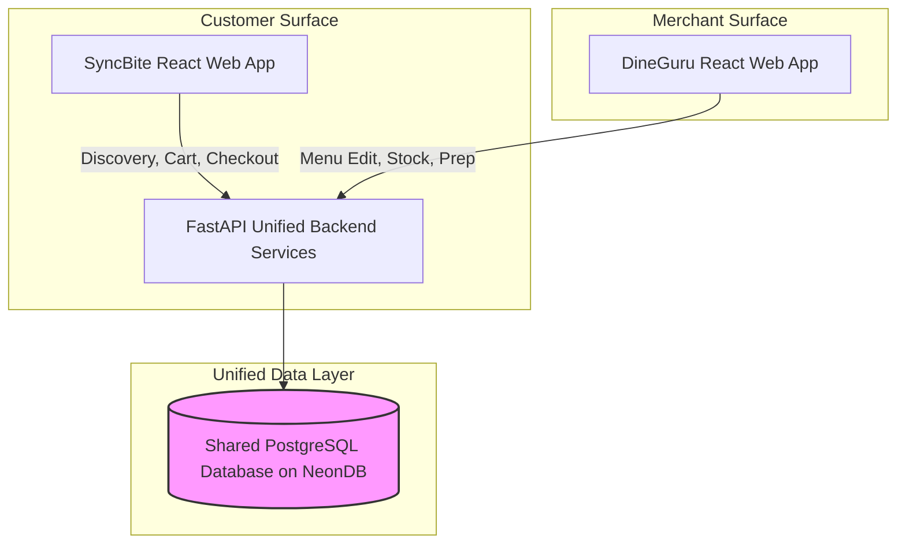

# PLATFORM FOUNDATION OVERVIEW

Version: 1.0  
Status: Authoritative Strategic Baseline  
Owner: Chief Architect & Product Leadership  

---

# Purpose

This document defines the strategic vision, mission, ecosystem alignment, core operational philosophy, and explicit product boundaries for SyncBite and DineGuru. 

It establishes the non-negotiable business rules and architectural foundation upon which all technical design decisions, database schemas, and service boundaries are built.

---

# Strategic Vision & Mission

## Vision
To become the definitive, high-velocity operating system for restaurant commerce, enabling seamless digital ordering, real-time kitchen fulfillment, and transparent financial operations.

While initially deployed to serve the dense campus and off-campus ecosystem of **VIT Vellore**, the architecture is designed from day one to support multi-city, multi-region expansion across Tamil Nadu and India without requiring structural redesigns.

## Mission
To eliminate operational friction for food merchants while delivering a hyper-responsive ordering experience for customers.

---

# Dual-Surface Platform Philosophy

SyncBite and DineGuru are NOT independent applications integrated via asynchronous API sync layers or separate databases. They represent **two distinct user interfaces over a unified platform and single PostgreSQL database**.

## Fundamental Separation Axioms
1. **Customers Interact Only with SyncBite**: Customers browse menus, manage addresses, apply coupons, place orders, make payments, and write reviews exclusively on SyncBite. Customers NEVER access DineGuru.
2. **Restaurants Interact Only with DineGuru**: Restaurant owners, branch managers, and kitchen staff manage catalogs, update inventory availability, accept orders, route prep, and view analytics exclusively on DineGuru. Restaurants NEVER use SyncBite.
3. **Database as Single Source of Truth**: Data created in DineGuru (e.g., menu items, stock changes) or SyncBite (e.g., new orders, payments) is written directly to the shared PostgreSQL database. No intermediate synchronization queues exist.

---

# Initial Deployment Context — VIT Vellore

Initial launch targets the specific operational constraints of the VIT Vellore ecosystem:

- **Merchant Base**: 100 to 500 food merchants (on-campus food courts, hostels, and off-campus dining establishments).
- **User Base**: 20,000+ active students, faculty, and campus residents generating peak dining order spikes (e.g., post-lecture hours).
- **Fulfillment Modes**: Direct restaurant delivery, customer campus pickup, and self-managed hostel delivery.

---

# Explicit Non-Goals (Scope Limits)

To preserve architectural focus and operational simplicity in Version 1.0, the platform intentionally excludes the following capabilities:

- **Third-Party Delivery Rider Subsystem**: Rider matching algorithms, driver mobile apps, and GPS tracking are excluded. Extension points are defined in [15-roadmap/multi-phase-evolution-roadmap.md](file:///Users/adith/Documents/Dev/LMX/SyncBite/architecture/15-roadmap/multi-phase-evolution-roadmap.md).
- **AI-Powered Recommendation Engines**: Complex Machine Learning recommendation pipelines and natural language dish search are deferred.
- **Consumer Wallets & Subscriptions**: Platform-managed user wallets and student pass subscriptions are excluded; all payments flow directly through Razorpay.
- **Table Reservation & Dine-In Ordering**: In-restaurant table QR ordering and table reservations are deferred to future roadmap phases.
