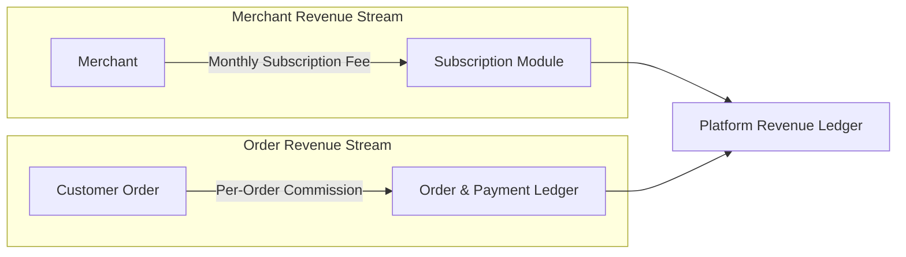

# BUSINESS MODEL & MONETIZATION SPECIFICATIONS

Version: 1.0  
Status: Authoritative Business Revenue Specification  
Owner: SyncBite Product & Business Engineering  

---

# Purpose

This document defines the dual monetization engine for the platform, combining merchant subscription plans for DineGuru and per-order platform commission fees collected on SyncBite orders.

---

# Dual Monetization Engine Architecture

The platform generates revenue through two complementary mechanisms:
1. **Recurring Merchant Subscriptions (DineGuru)**: Fixed monthly software access fees paid by merchants for store management, catalog administration, inventory control, and kitchen workflow dispatch tools.
2. **Transactional Order Commissions (SyncBite)**: Percentage or flat platform commission fees collected on every completed customer food order processed through SyncBite.

---

# Subscription Tiers (DineGuru)

Merchant subscriptions are owned by the `subscription` domain module. Tier configuration dictates active feature permissions across DineGuru.

| Subscription Tier | Targeted Merchant Type | Allowed Active Branches | Advanced Features | Billing Cycle |
| :--- | :--- | :--- | :--- | :--- |
| **Basic** | Single-location independent campus stalls | Max 1 Branch | Standard catalog & order acceptance | Monthly recurring |
| **Professional** | Multi-branch campus & off-campus dining | Up to 5 Branches | Inventory tracking, recipe management | Monthly / Annual |
| **Enterprise** | Multi-brand restaurant groups / franchises | Unlimited Branches | Multi-kitchen routing, advanced analytics | Custom billing |

---

# Platform Order Commission Model

Per-order commissions are calculated during order checkout by the `subscription` / financial calculation logic and logged in the append-only payment ledger ([14-adrs/ADR-0012](file:///Users/adith/Documents/Dev/LMX/SyncBite/architecture/14-adrs/ADR-0012-append-only-payment-ledger-and-refunds.md)).

## Commission Calculation Formula
For a given customer order at a specific Branch $b$:

$$\text{Gross Order Value } (G) = \sum (\text{Item Price} \times \text{Quantity}) - \text{Merchant Discounts}$$

$$\text{Platform Commission } (C) = (G \times \text{Commission Rate}_b) + \text{Fixed Fee}_b$$

$$\text{Merchant Net Payout } (P) = G - C$$

## Financial Auditability Rules
1. **Immutability**: Once an order is paid and verified via Razorpay, the calculated commission $C$ and payout $P$ MUST be logged as immutable records in `platform_commissions`.
2. **Refund Recalculation**: If an order is canceled or refunded, refund adjustments MUST be recorded as new append-only ledger entries; existing commission calculations MUST NOT be deleted.
