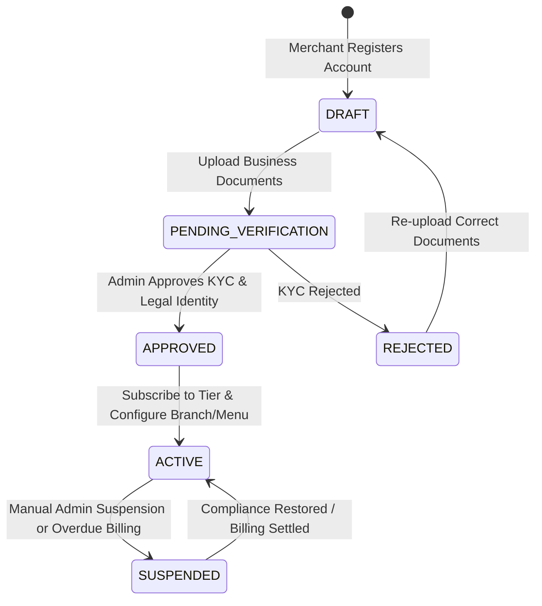
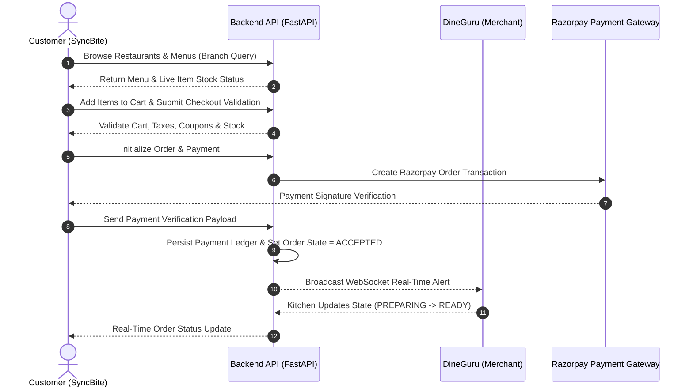

# MERCHANT & CUSTOMER JOURNEYS SPECIFICATIONS

Version: 1.0  
Status: Authoritative User Workflow Specification  
Owner: SyncBite Product & Business Engineering  

---

# Purpose

This document defines the lifecycle states and operational workflows for both user populations: Merchants operating through **DineGuru** and Customers ordering through **SyncBite**.

---

# Merchant Journey & Lifecycle (DineGuru)

Merchants progress through a formal onboarding and verification lifecycle managed by `merchant` and `08-admin` operational interfaces.

## Lifecycle States
1. **DRAFT**: Initial registration; merchant account created, tax/KYC documents pending upload.
2. **PENDING_VERIFICATION**: Business registration, FSSAI licenses, and bank account details submitted to `08-admin` review queue.
3. **APPROVED**: Admin approval complete; merchant assigned legal `merchant_id`.
4. **ACTIVE**: DineGuru subscription activated; Brand, Branch, and Menu configured; receiving customer orders.
5. **SUSPENDED**: Operational write access disabled due to compliance violations or billing delinquency.

---

# Customer Journey (SyncBite)

The customer workflow spans discovery, catalog inspection, cart building, checkout validation, payment, real-time tracking, and review submission.

---

# Operational Policies & Cancellation Rules

## Order Cancellation Policy
1. **Customer-Initiated Cancellation**:
   * Allowed ONLY when order state is `PLACED` or `PENDING_PAYMENT` (prior to merchant acceptance).
   * Forbidden once order transitions to `ACCEPTED` or `PREPARING` by the merchant.
2. **Merchant-Initiated Cancellation**:
   * Merchants MAY reject an order prior to prep if items are out of stock or branch is overloaded.
   * Merchant rejection MUST trigger an automated full refund via Razorpay ([14-adrs/ADR-0012](file:///Users/adith/Documents/Dev/LMX/SyncBite/architecture/14-adrs/ADR-0012-append-only-payment-ledger-and-refunds.md)).

## Branch Operating Hours Policy
- Branch order placement MUST be strictly blocked by backend validation outside configured store operating hours or when store status is toggled to `OFFLINE` in DineGuru.
