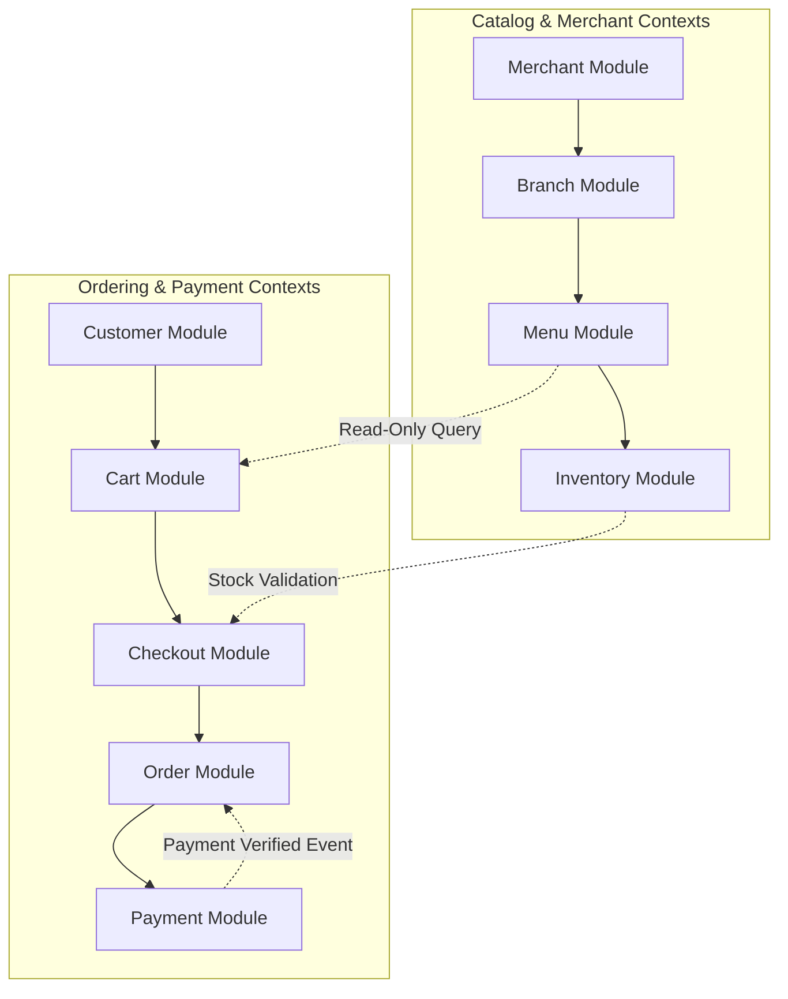

# BOUNDED CONTEXTS & AGGREGATE ROOTS SPECIFICATIONS

Version: 1.0  
Status: Authoritative DDD Aggregate Specification  
Owner: Chief Architect & Domain Modeling Group  

---

# Purpose

This document defines the formal Domain-Driven Design (DDD) aggregate boundaries, bounded contexts, and single-source-of-truth ownership matrix across the 17 business domain modules.

---

# Domain Ownership Matrix (17 Bounded Contexts)

Every aggregate root and entity in the platform MUST have exactly ONE owning business domain module. No entity MAY be modified by an unauthorized module.

| Bounded Context | Authoritative Module Directory | Aggregate Root Entity | Included Child Entities / Value Objects |
| :--- | :--- | :--- | :--- |
| **Authentication & Identity** | `07-modules/auth/` | `User` | UserCredentials, UserRoles, AuthTokens |
| **Customer Management** | `07-modules/customer/` | `CustomerProfile` | CustomerAddress, CustomerFavorite |
| **Merchant Legal Entity** | `07-modules/merchant/` | `Merchant` | MerchantKYC, BankAccountDetails |
| **Brand Umbrella** | `07-modules/brand/` | `Brand` | BrandMetadata, BrandAssets |
| **Physical Branch** | `07-modules/branch/` | `Branch` | BranchOperatingHours, DeliveryZone |
| **Kitchen Preparation** | `07-modules/kitchen/` | `Kitchen` | KitchenStation, PreparationQueue |
| **Catalog & Menu** | `07-modules/menu/` | `Menu` | MenuCategory, MenuItem, ModifierGroup, Modifier |
| **Inventory Management** | `07-modules/inventory/` | `InventoryItem` | StockLog, IngredientItem (DineGuru Exclusive) |
| **Search Engine** | `07-modules/search/` | `SearchQuery` | SearchFilter, RelevanceRank |
| **Shopping Cart** | `07-modules/cart/` | `Cart` | CartItem, CartSummary |
| **Order Checkout** | `07-modules/checkout/` | `CheckoutSession` | CheckoutValidationResult, FeeSummary |
| **Order Processing** | `07-modules/order/` | `Order` | OrderItem, OrderStatusLog, OrderCancelReason |
| **Payment Ledger** | `07-modules/payment/` | `Payment` | PaymentTransaction, RefundTransaction |
| **Coupon Engine** | `07-modules/coupon/` | `Coupon` | CouponRedemption, DiscountRule |
| **Reviews & Feedback** | `07-modules/review/` | `Review` | ReviewRating, ModerationStatus |
| **Notifications Engine** | `07-modules/notification/` | `Notification` | NotificationLog, DeviceToken |
| **Merchant Subscription** | `07-modules/subscription/` | `Subscription` | PlatformCommission, SubscriptionPlan |

---

# Bounded Context Relationships

## Boundary Isolation Rules
1. **Direct Database Modification Prohibited**: The `checkout` module MUST NOT update tables owned by `inventory` or `order` directly via SQL; it MUST call the `order` service interface.
2. **Read-Only Cross-Context Queries**: The `cart` module queries `menu` data in read-only mode to fetch current item pricing during cart updates.
