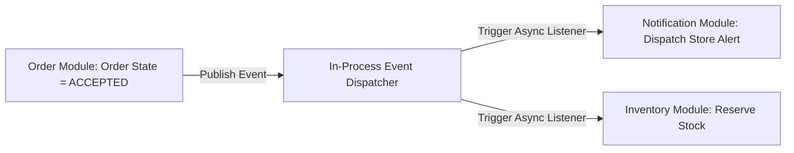

# DOMAIN INVARIANTS & DOMAIN EVENTS SPECIFICATIONS

Version: 1.0  
Status: Authoritative Invariants & Events Specification  
Owner: Chief Architect & Domain Modeling Group  

---

# Purpose

This document specifies the non-negotiable domain invariants (business rules) enforced across all aggregate roots and defines the payload contracts for in-process domain events.

---

# Master Domain Invariants Registry

Every domain invariant MUST identify its authoritative owner module. Domain invariants MUST be validated at the domain layer inside aggregate roots before any state persistence occurs.

| Invariant ID | Domain Invariant Rule | Authoritative Module | Enforcement Rationale |
| :--- | :--- | :--- | :--- |
| **INV-0001** | An `Order` MUST belong to exactly one physical `Branch`. | `order` | Guarantees operational kitchen assignment and store billing integrity. |
| **INV-0002** | `InventoryItem` stock levels MUST be updated exclusively through `DineGuru` routes. | `inventory` | Prevents uncoordinated stock mutations from customer clients ([14-adrs/ADR-0006](file:///Users/adith/Documents/Dev/LMX/SyncBite/architecture/14-adrs/ADR-0006-inventory-ownership-write-rule.md)). |
| **INV-0003** | A `Payment` transaction record MUST be append-only and immutable once written. | `payment` | Preserves 100% financial auditability and prevents fraud ([14-adrs/ADR-0012](file:///Users/adith/Documents/Dev/LMX/SyncBite/architecture/14-adrs/ADR-0012-append-only-payment-ledger-and-refunds.md)). |
| **INV-0004** | A `Coupon` MUST NOT modify historical orders or previously calculated commissions. | `coupon` | Prevents financial retro-active ledger distortion. |
| **INV-0005** | An `Order` MUST NOT be accepted if any included item is marked `OUT_OF_STOCK`. | `checkout` / `order` | Prevents ghost orders and kitchen fulfillment failures. |
| **INV-0006** | A `Branch` MUST NOT accept orders outside its configured `operating_hours`. | `branch` | Protects store operational capacity and prevents unfulfilled off-hours orders. |
| **INV-0007** | A `Customer` MAY review a `Branch` ONLY if they have a completed `Order` at that branch. | `review` | Prevents review spam and unverified feedback manipulation. |

---

# Domain Events Registry

Domain events are enqueued to the in-process async event dispatcher ([14-adrs/ADR-0007](file:///Users/adith/Documents/Dev/LMX/SyncBite/architecture/14-adrs/ADR-0007-in-process-domain-event-propagation.md)) upon successful domain state transitions.

## Baseline Domain Event Contracts

1. **`OrderPlacedEvent`**:
   * **Publisher**: `checkout` / `order` module.
   * **Consumers**: `notification`, `inventory`, `08-admin`.
   * **Payload**: `{ "order_id": "...", "branch_id": "...", "customer_id": "...", "total_amount": 450.00, "placed_at": "..." }`
2. **`PaymentVerifiedEvent`**:
   * **Publisher**: `payment` module.
   * **Consumers**: `order`, `notification`.
   * **Payload**: `{ "payment_id": "...", "order_id": "...", "razorpay_payment_id": "...", "amount": 450.00, "status": "CAPTURED" }`
3. **`InventoryDepletedEvent`**:
   * **Publisher**: `inventory` module (DineGuru).
   * **Consumers**: `menu`, `search`.
   * **Payload**: `{ "branch_id": "...", "item_id": "...", "status": "OUT_OF_STOCK", "updated_at": "..." }`
