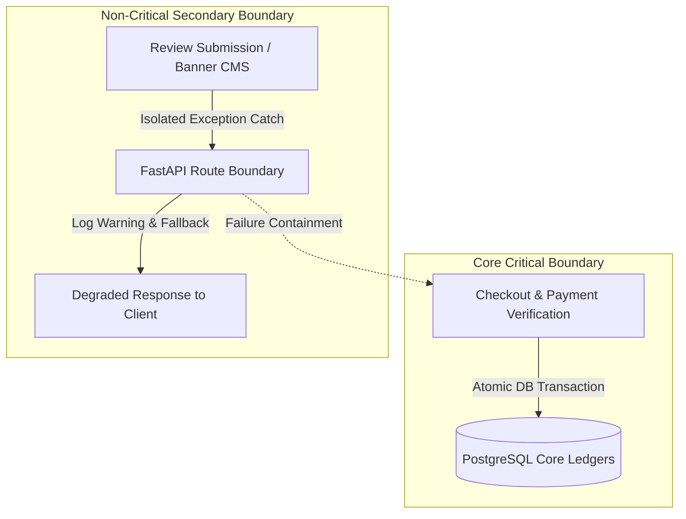

# FAILURE & ISOLATION BOUNDARIES SPECIFICATIONS

Version: 1.0  
Status: Authoritative Failure Isolation Specification  
Owner: Chief Architect & Operations Engineering  

---

# Purpose

This document specifies the system-wide failure containment boundaries, blast radius controls, circuit breaker policies, and graceful degradation modes governing SyncBite and DineGuru.

---

# System Failure Boundaries (WHY Before HOW)

## Why Explicit Failure Isolation Exists
In a monolithic container application sharing a single database, an unhandled exception or connection leak in a secondary feature (such as customer review submission or banner image fetching) MUST NOT crash core revenue-generating operations (such as order checkout or Razorpay payment verification). 

Failure isolation boundaries guarantee that non-essential subsystem failures are contained locally without cascading into total platform outages.

---

# External Vendor Failure Containment

| External Dependency | Potential Failure Mode | Containment & Circuit Breaker Strategy | Graceful Degradation Mode |
| :--- | :--- | :--- | :--- |
| **Razorpay Payment Gateway** | Gateway timeout / 502 Bad Gateway | Timeout capped at 10 seconds; 3 retries with exponential backoff. | Display explicit "Payment Provider Unavailable" notice; allow order draft saving. |
| **SendGrid Email API** | API rate limit / outage | Non-blocking execution inside FastAPI `BackgroundTasks`. | Enqueue notification record in DB; retry dispatch asynchronously without blocking API. |
| **NeonDB PostgreSQL Database** | Connection pool exhaustion | Max connection pool limit capped; idle connection timeout = 10s. | Reject new non-essential read queries with HTTP 503; preserve pool for active checkout transactions. |

---

# Graceful Degradation Protocols

1. **Database Connection Saturation**: If database connection pool utilization exceeds 95%, non-critical API routes (`GET /api/v1/reviews`, `GET /api/v1/admin/banners`) MUST fail fast with `HTTP 503 Service Unavailable`, preserving remaining connections for active `order` and `payment` verification routes.
2. **WebSocket Dispatch Degradation**: If real-time WebSocket connections drop during DineGuru store operations, DineGuru clients MUST fall back to a low-frequency HTTP polling check (`GET /api/v1/branches/{id}/orders/pending` every 15 seconds) until WebSockets reconnect.
