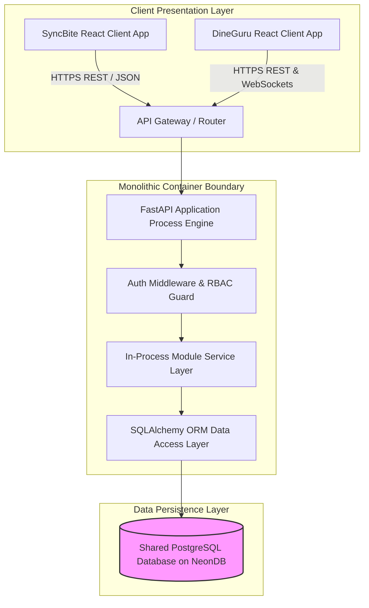

# SYSTEM ARCHITECTURE & COMPONENT BOUNDARIES SPECIFICATIONS

Version: 1.0  
Status: Authoritative Container & Boundary Specification  
Owner: Chief Architect & Infrastructure Engineering  

---

# Purpose

This document specifies the high-level system container layout, internal component communication boundaries, and protocol standards governing the FastAPI backend, SyncBite customer web app, DineGuru merchant web app, and PostgreSQL data persistence layer.

---

# High-Level Container Topology

## Why a Monolithic Container Deployment Exists (WHY Before HOW)
The platform is containerized as a single FastAPI process container running on cloud infrastructure (e.g. AWS ECS / GCP Cloud Run / Render). 

Deploying a single application container eliminates network hop latency between business domains, prevents complex distributed tracing overhead, and allows atomic database transactions across domain boundaries while maintaining an operationally simple footprint for target scale (500 restaurants, 20,000+ users).

---

# Inter-Module Communication Protocols

Internal communication between business domain modules inside `07-modules/` MUST adhere to strict protocol boundaries:

1. **Synchronous In-Process Service Invocation**:
   * Modules MUST expose a public `Service` class interface (e.g. `OrderService`, `InventoryService`).
   * Calling modules MUST invoke method signatures on the public service interface. Direct cross-module imports of SQLAlchemy ORM data models are strictly forbidden.
2. **Asynchronous In-Process Domain Event Publishing**:
   * For non-critical side effects (sending email receipts, logging audit trails), modules MUST publish domain events ([02-domain-model/domain-invariants-and-events.md](file:///Users/adith/Documents/Dev/LMX/SyncBite/architecture/02-domain-model/domain-invariants-and-events.md)) to the in-process event dispatcher ([14-adrs/ADR-0007](file:///Users/adith/Documents/Dev/LMX/SyncBite/architecture/14-adrs/ADR-0007-in-process-domain-event-propagation.md)).
