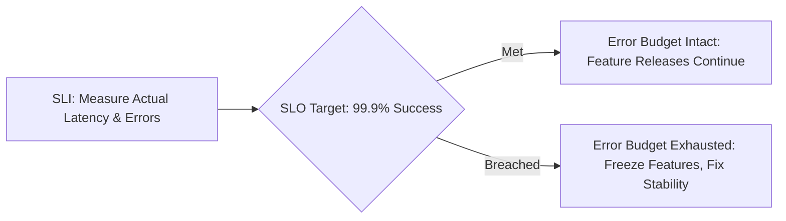

# PERFORMANCE, SCALABILITY & SERVICE LEVEL AGREEMENTS

Version: 1.0  
Status: Authoritative NFR Performance & Capacity Specification  
Owner: Chief Architect & Operations Engineering  

---

# Purpose

This document defines the quantitative latency budgets, database query performance limits, throughput capacities, scaling bounds, SLAs, SLOs, SLIs, and error budget policies for SyncBite and DineGuru.

---

# Quantitative Latency Budgets

All API endpoints MUST satisfy the following strict latency thresholds under normal operating load ($< 80\%$ capacity limit).

| Endpoint Class | Target p95 Latency | Target p99 Latency | Max DB Query Budget | Notes |
| :--- | :--- | :--- | :--- | :--- |
| **Read Operations (Catalog / Search)** | $< 100\text{ms}$ | $< 250\text{ms}$ | $< 15\text{ms}$ (total DB time) | Menu reads, dish search, restaurant listings |
| **Cart Operations** | $< 150\text{ms}$ | $< 350\text{ms}$ | $< 25\text{ms}$ | Add/remove items, update quantities |
| **Checkout Validation & Order Creation** | $< 300\text{ms}$ | $< 600\text{ms}$ | $< 50\text{ms}$ | Transactional order creation & Razorpay init |
| **Payment Signature Verification** | $< 200\text{ms}$ | $< 400\text{ms}$ | $< 30\text{ms}$ | Webhook processing & payment verification |
| **Merchant Store/Inventory Updates** | $< 150\text{ms}$ | $< 300\text{ms}$ | $< 20\text{ms}$ | DineGuru stock toggle & menu item status |

---

# Throughput & Capacity Planning

The initial platform version MUST comfortably support the following target scale without structural redesign or degraded latency:

- **Active Merchants**: 100 to 500 food merchants.
- **Active User Base**: 20,000+ registered customers (VIT Vellore campus & surrounding areas).
- **Peak Throughput**: 50 orders per second during peak dining hours (12:00 PM–2:00 PM and 7:00 PM–9:00 PM).
- **Database Connection Pool**: Up to 100 concurrent serverless PostgreSQL connections managed via NeonDB connection pooling (PgBouncer).

---

# SLAs, SLOs & Error Budgets

## Service Level Agreement (SLA)
- **Target Availability**: 99.9% Uptime per calendar month (excluding scheduled maintenance windows).
- **Scheduled Maintenance Window**: Maximum 2 hours per month, executed during off-peak hours (2:00 AM–4:00 AM IST).

## Service Level Objectives (SLOs) & Indicators (SLIs)

1. **Availability SLO**: 99.9% of non-synthetic HTTP requests MUST return non-5xx status codes over any 30-day rolling window.
2. **Latency SLO**: 95.0% of HTTP GET requests MUST complete in $< 150\text{ms}$; 95.0% of HTTP POST/PUT requests MUST complete in $< 300\text{ms}$.
3. **Error Budget Policy**: If monthly 5xx errors exceed 0.1% of total request volume (exhausting the error budget), non-critical feature deployments MUST be paused until stability is restored.
