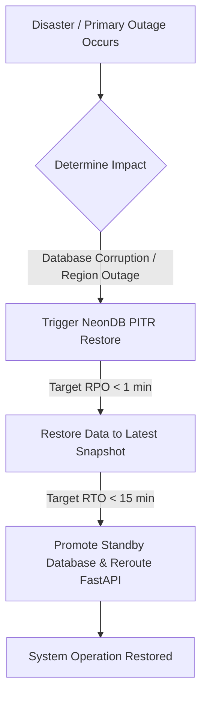

# RESILIENCE, DISASTER RECOVERY & SECURITY NFR SPECIFICATIONS

Version: 1.0  
Status: Authoritative Resilience, DR & Security NFR Specification  
Owner: Chief Architect & Security/DevOps Engineering  

---

# Purpose

This document specifies the non-functional requirements governing system resilience, Disaster Recovery (DR), Recovery Time Objective (RTO), Recovery Point Objective (RPO), database backup retention strategies, field-level security controls, and OWASP compliance standards for SyncBite and DineGuru.

---

# Resilience & Fault Tolerance Targets

1. **Circuit Breakers & Degradation Modes**: External third-party calls (Razorpay payments, Email/SMS notification gateways) MUST execute behind isolated timeouts and circuit breakers. If Razorpay is degraded, SyncBite MUST gracefully display payment retry interfaces rather than throwing unhandled 500 errors.
2. **Stateless Container Failover**: FastAPI application instances MUST remain 100% stateless. Any crashing process container MUST be automatically restarted by container orchestrators within $< 10\text{seconds}$ without losing active user sessions (sessions are authenticated via self-contained JWT tokens).

---

# Disaster Recovery (DR) — RTO & RPO Targets

## Recovery Point Objective (RPO)
- **RPO Target**: $< 1\text{ minute}$.
- **Mechanism**: NeonDB Continuous Write-Ahead Logging (WAL) archiving and serverless storage architecture. In the event of a catastrophic failure, maximum allowable data loss is $< 60\text{ seconds}$ of committed transactions.

## Recovery Time Objective (RTO)
- **RTO Target**: $< 15\text{ minutes}$.
- **Mechanism**: Automated database point-in-time recovery (PITR) combined with multi-AZ serverless database failover and automated container redeployment.

## Backup & Retention Policy
- **Continuous Write-Ahead Logging (WAL)**: Retained for 7 rolling days to support point-in-time recovery to any exact second.
- **Daily Automated Database Snapshots**: Executed daily at 03:00 AM IST and retained for 30 rolling days.
- **Monthly Archival Snapshots**: Retained for 12 months for financial reconciliation and audit compliance.

---

# Security & Compliance NFRs

1. **Transport Security (TLS 1.3)**: 100% of external web traffic to SyncBite, DineGuru, and FastAPI backends MUST be encrypted in transit using TLS 1.3 (TLS 1.2 minimum). Unencrypted HTTP traffic MUST be automatically redirected.
2. **Field-Level Encryption at Rest**: Sensitive Customer Personally Identifiable Information (PII) and OAuth refresh tokens MUST be encrypted at rest in PostgreSQL using AES-256 GCM authenticated encryption.
3. **OWASP Top 10 Compliance**:
   * **SQL Injection**: Prevented via mandatory SQLAlchemy parameterized ORM queries; raw string-concatenated SQL queries are strictly forbidden.
   * **Broken Object-Level Authorization (BOLA)**: Every API endpoint MUST verify that the authenticated User ID matches the owner ID of the requested resource.
   * **Cross-Site Scripting (XSS)**: All user inputs (reviews, store names, dish descriptions) MUST be sanitized prior to rendering.
4. **Audit Trail Retention**: Administrative actions, merchant onboarding approvals, refund authorizations, and security setting modifications MUST produce immutable audit records retained for a minimum of 7 years.
