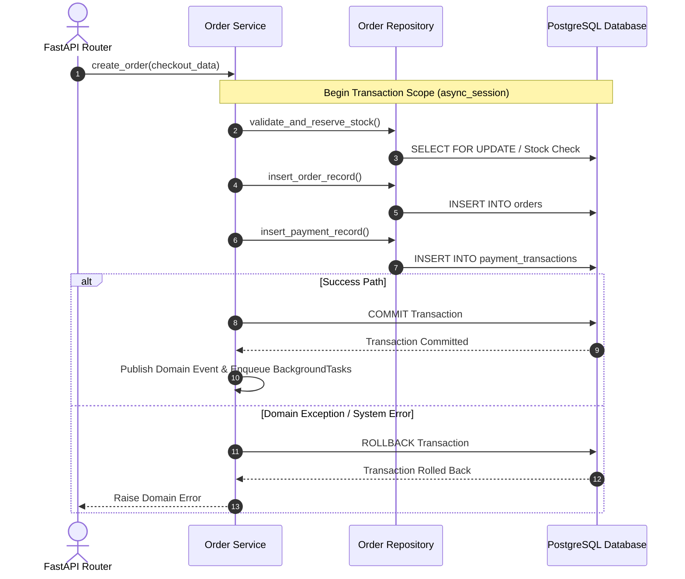

# CONCURRENCY, TRANSACTIONS & BACKGROUND TASKS SPECIFICATIONS

Version: 1.0  
Status: Authoritative Concurrency & Transaction Specification  
Owner: Chief Architect & Backend Engineering Lead  

---

# Purpose

This document specifies database transaction scoping, atomic commit/rollback boundaries, concurrency handling assumptions, and async `BackgroundTasks` execution rules within the FastAPI backend framework.

---

# Database Transaction Scope & Atomic Boundaries

Database transaction scoping MUST be managed explicitly at the **Service Layer** boundary using SQLAlchemy async sessions (`async_session`).

## Mandatory Transaction Rules
1. **Explicit Commit Ownership**: Transaction commits (`await session.commit()`) MUST execute exclusively in the Service layer. Repositories MUST NOT commit transactions.
2. **Atomic Rollback Guarantee**: If any exception occurs during multi-table operations (e.g. order creation, payment transaction log insertion, or inventory reduction), the session MUST execute `await session.rollback()` to preserve ACID consistency.
3. **Short-Lived Transactions**: Transactions MUST NOT encompass external network calls (e.g. calling Razorpay APIs or sending email notifications). All external API calls MUST execute outside active database transaction blocks.

---

# Service & Repository Boundaries

- **Repository Boundary Isolation**: A module repository (e.g. `OrderRepository`) MUST execute SQL queries exclusively against tables owned by that module (`orders`, `order_items`, `order_status_logs`).
- **Cross-Module Service Interactions**: If `OrderService` requires inventory checks, it MUST invoke `InventoryService.validate_stock()`, which executes queries via `InventoryRepository`. Direct cross-repository access across module boundaries is forbidden.

---

# Async Background Tasks Execution

To prevent slow non-critical side effects (e.g., sending transactional receipt emails, emitting audit metrics, pushing analytics logs) from delaying API responses, non-blocking tasks MUST execute asynchronously post-response using FastAPI's `BackgroundTasks` runner.

## Background Task Rules
1. **Post-Commit Execution**: Background tasks MUST be enqueued ONLY after the primary database transaction has successfully committed. Enqueuing tasks prior to transaction commit risks dispatching notifications for rolled-back orders.
2. **Idempotency**: Background tasks MUST be idempotent. If a background task retries (e.g., re-sending a notification email), it MUST verify that the action has not already been completed.
3. **Volatiles Handling**: Background tasks execute in-memory within the FastAPI process. Critical domain state (such as payment records or order state) MUST be transactionally committed to PostgreSQL *before* enqueuing background tasks.
