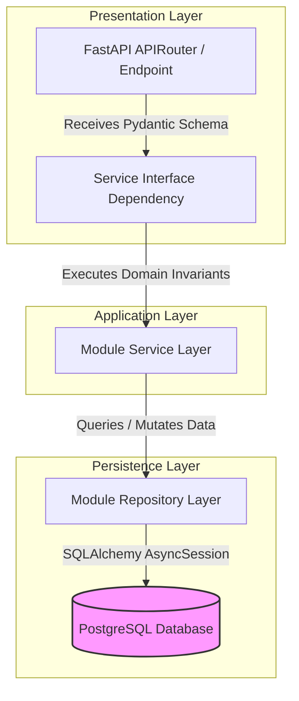

# FASTAPI ARCHITECTURE & LAYERED SOFTWARE SPECIFICATIONS

Version: 1.0  
Status: Authoritative FastAPI Software Architecture Specification  
Owner: Chief Architect & Backend Engineering Lead  

---

# Purpose

This document specifies the internal software layering standards, Dependency Injection (DI) rules, input validation strategy, exception handling framework, and structured logging setup for the FastAPI backend service.

---

# Layered Software Architecture

To enforce strict domain isolation within the modular monolith ([14-adrs/ADR-0001](file:///Users/adith/Documents/Dev/LMX/SyncBite/architecture/14-adrs/ADR-0001-modular-monolith-architecture.md)), code MUST follow a 4-tier unidirectional dependency structure:

$$\text{Presentation Layer (Router)} \longrightarrow \text{Application Layer (Service)} \longrightarrow \text{Domain / Persistence Layer (Repository)} \longrightarrow \text{Database Model}$$



## Mandatory Layering Rules
1. **Router Layer**: Responsible solely for HTTP status codes, parsing Pydantic request bodies, extracting JWT claims, and delegating execution to the Service layer. Routers MUST NOT contain database queries or domain validation logic.
2. **Service Layer**: Responsible for executing domain invariants, transaction scoping, publishing domain events, and orchestrating cross-repository actions. Services MUST NOT import FastAPI HTTP request/response objects.
3. **Repository Layer**: Responsible exclusively for executing SQLAlchemy ORM queries against PostgreSQL tables owned by the module. Repositories MUST NOT execute business validation logic.
4. **Cross-Module Imports**: Service layers MAY import other module's Service interfaces, but MUST NEVER import another module's Repository or SQLAlchemy ORM Model directly.

---

# Dependency Injection (DI) Strategy

FastAPI's native `Depends()` mechanism is the mandatory framework for injecting dependencies across all layer boundaries:

- **Database Session Injection**: `async_session: AsyncSession = Depends(get_db_session)` injects scoped, auto-closing SQLAlchemy async sessions.
- **Authentication Context**: `current_user: UserClaims = Depends(get_current_user)` parses and validates bearer JWT tokens ([14-adrs/ADR-0004](file:///Users/adith/Documents/Dev/LMX/SyncBite/architecture/14-adrs/ADR-0004-multi-tenant-authentication-identity-strategy.md)).
- **Service Instantiation**: `order_service: OrderService = Depends(get_order_service)` injects configured domain service instances.

---

# Validation Strategy & Exception Handling

## Pydantic Schema Validation
- All API request bodies and query parameters MUST be validated via Pydantic v2 schemas (`BaseModel` subclasses with strict type annotations).
- Invalid requests MUST fail fast at the Router boundary with standard `422 Unprocessable Entity` payloads detailing validation field errors.

## Global Exception Handling
Custom domain exceptions (e.g. `DomainInvariantViolationError`, `EntityNotFoundError`, `InsufficientStockError`) thrown in the Service layer MUST be intercepted by FastAPI global exception handlers and translated into standard HTTP error responses ([06-api/authorization-errors-and-rate-limiting.md](file:///Users/adith/Documents/Dev/LMX/SyncBite/architecture/06-api/authorization-errors-and-rate-limiting.md)).

```python
# Standardized Error Translation Schema
@app.exception_handler(DomainInvariantViolationError)
async def domain_error_handler(request: Request, exc: DomainInvariantViolationError):
    return JSONResponse(
        status_code=400,
        content={
            "error_code": exc.error_code,
            "message": exc.message,
            "details": exc.details,
            "correlation_id": request.state.correlation_id,
        },
    )
```

---

# Structured Logging Strategy

- **Logger Library**: All logging MUST use `structlog` configured to emit single-line JSON logs to standard stdout.
- **Correlation ID Propagation**: Middleware MUST inject a unique `X-Correlation-ID` header into every request context, binding it to all structlog log entries emitted during that request lifecycle.
- **PII Scrubbing**: Sensitive fields (`password`, `jwt_token`, `credit_card`, `otp`) MUST be sanitized by structlog processors before log output.
