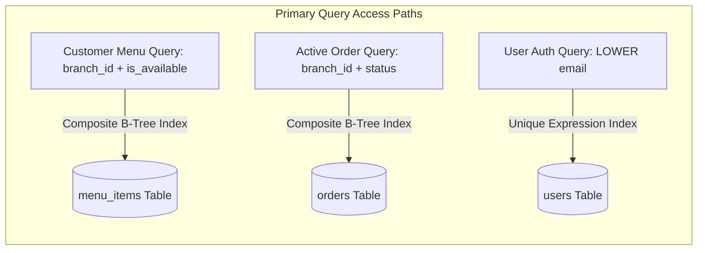

# INDEXING, MIGRATIONS & AUDITING SPECIFICATIONS

Version: 1.0  
Status: Authoritative Database Performance & Operational Specification  
Owner: Chief Architect & Lead Database Engineer  

---

# Purpose

This document specifies the PostgreSQL index strategy, Alembic database migration procedures, soft delete query filters, and audit trail timestamping rules governing the shared PostgreSQL database.

---

# PostgreSQL Index Strategy & Justifications

Indexes MUST be explicitly justified by expected query access patterns. Every index introduces write overhead; un-indexed foreign keys or query filters cause table scans.

## Mandatory Core Indexes & Justifications

| Target Table | Index Name | Type | Indexed Columns | Query Pattern Rationale |
| :--- | :--- | :--- | :--- | :--- |
| **`users`** | `idx_users_email_lower` | Unique B-Tree | `LOWER(email)` | Fast case-insensitive user authentication lookups. |
| **`branches`** | `idx_branches_brand_id` | B-Tree | `brand_id` | Foreign key lookup for retrieving all branches of a brand. |
| **`menu_items`** | `idx_menu_items_branch_avail` | Composite B-Tree | `branch_id, is_available` | Customer catalog browsing; filters active items by store. |
| **`inventory_items`**| `idx_inventory_branch_item` | Composite Unique | `branch_id, menu_item_id` | Instant stock check during checkout validation. |
| **`orders`** | `idx_orders_branch_status` | Composite B-Tree | `branch_id, status, created_at DESC` | DineGuru kitchen dashboard queries for active orders. |
| **`orders`** | `idx_orders_customer` | B-Tree | `customer_profile_id, created_at DESC` | Customer order history listing on SyncBite. |
| **`payments`** | `idx_payments_order_id` | Unique B-Tree | `order_id` | 1:1 payment record retrieval for an order. |
| **`payment_transactions`**| `idx_pay_tx_razorpay_id` | B-Tree | `razorpay_payment_id` | Fast webhook callback matching during payment verification. |

---

# Alembic Migration Pipeline & DDL Standards

1. **Versioned Migration Scripts**: All DDL changes MUST be version-controlled using Alembic migration scripts stored in `backend/alembic/versions/`.
2. **Zero-Downtime DDL Rules**:
   * Adding columns MUST be nullable or have a safe default value to prevent locking tables during deployment.
   * Creating indexes MUST execute `CREATE INDEX CONCURRENTLY` to prevent blocking active write queries.
   * Column drops MUST be executed in a multi-stage release (deprecate code read $\rightarrow$ remove code $\rightarrow$ drop column).

---

# Audit Logging & Timestamping Rules

## Standard Timestamp Columns
Every table in the database MUST include the following UTC timestamp columns:
- **`created_at`**: `TIMESTAMP WITH TIME ZONE NOT NULL DEFAULT CURRENT_TIMESTAMP`. Set at row creation; NEVER modified.
- **`updated_at`**: `TIMESTAMP WITH TIME ZONE NOT NULL DEFAULT CURRENT_TIMESTAMP`. Updated automatically via PostgreSQL trigger on row mutation.
- **`deleted_at`**: `TIMESTAMP WITH TIME ZONE NULL`. Set when a soft delete occurs.

## Immutable Administrative Audit Trail (`admin_audit_logs`)
All administrative mutations (e.g. approving merchants, issuing manual refunds, altering store status) MUST execute an explicit INSERT into `admin_audit_logs`:

$$\text{Audit Payload: } \{\text{id}, \text{user\_id}, \text{action}, \text{target\_entity}, \text{changes\_json}, \text{ip\_address}, \text{created\_at}\}$$

`admin_audit_logs` records MUST be retained for a minimum of 7 years and MUST NOT be deleted or altered.
