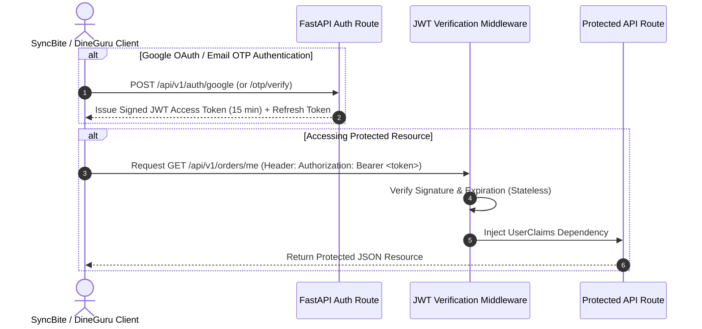

# API DESIGN, AUTHENTICATION & ENDPOINT SPECIFICATION STANDARDS

Version: 1.0  
Status: Authoritative REST & Authentication Specification  
Owner: Chief Architect & API Engineering Lead  

---

# Purpose

This document defines the REST API design conventions, URL versioning standards, authentication header parsing, JWT/OAuth flow protocols, and mandatory endpoint specification attributes for SyncBite and DineGuru.

---

# REST Design & Versioning Standards

All API routes MUST adhere to standard RESTful conventions:

1. **Explicit URL Major Path Versioning**: All routes MUST include `/api/v1/` prefix ([14-adrs/ADR-0008](file:///Users/adith/Documents/Dev/LMX/SyncBite/architecture/14-adrs/ADR-0008-api-versioning-and-backward-compatibility.md)).
2. **Resource Nouns (No Verbs)**: Routes MUST use plural resource nouns (e.g. `GET /api/v1/orders`, `POST /api/v1/cart/items`). Action verbs in URLs are strictly forbidden.
3. **JSON Naming Standards**: All API request/response JSON payloads MUST use lower `snake_case` field names (e.g. `customer_id`, `created_at`).

---

# Authentication & Token Protocols

Authentication MUST follow the Multi-Tenant Identity Strategy ([14-adrs/ADR-0004](file:///Users/adith/Documents/Dev/LMX/SyncBite/architecture/14-adrs/ADR-0004-multi-tenant-authentication-identity-strategy.md)):

- **Header Format**: `Authorization: Bearer <access_token>`
- **Token Claims**: Payload MUST embed `sub` (User ID), `role` (`Customer`, `BranchManager`, etc.), `merchant_id` (if applicable), and `exp` (expiration epoch).

---

# Mandatory Endpoint Specification Attributes

Every API endpoint documented in this repository (in `07-modules/` or `08-admin/`) MUST explicitly define the following 8 architectural attributes:

| Attribute | Definition & Requirements |
| :--- | :--- |
| **1. Owner Module** | The single authoritative domain module inside `07-modules/` that owns the endpoint. |
| **2. Authentication** | `NONE` (Public), `BEARER_JWT` (Customer/Merchant), or `OAUTH_CALLBACK`. |
| **3. Authorization** | Mandatory RBAC role check (`Customer`, `BranchManager`, `PlatformAdmin`, etc.). |
| **4. Idempotency** | `IDEMPOTENT` (GET, PUT, DELETE) vs `NON_IDEMPOTENT` (POST requiring `X-Idempotency-Key`). |
| **5. Transaction Scope** | Explicit atomic PostgreSQL transaction boundaries (`READ_ONLY`, `READ_WRITE_SINGLE`, `READ_WRITE_ATOMIC_MULTITABLE`). |
| **6. Failure Modes** | Documented HTTP 4xx/5xx failure response triggers. |
| **7. Retry Behavior** | Safe client retry guidelines (`SAFE_IMMEDIATE_RETRY`, `RETRY_WITH_EXPONENTIAL_BACKOFF`, `DO_NOT_RETRY`). |
| **8. Latency Target** | Quantified p95 latency budget (e.g. $< 150\text{ms}$). |
