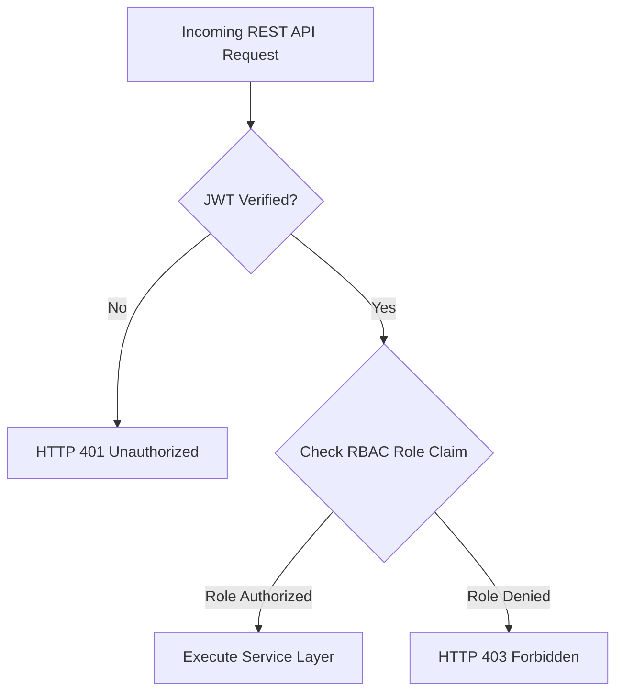

# AUTHORIZATION, ERROR SCHEMAS & RATE LIMITING SPECIFICATIONS

Version: 1.0  
Status: Authoritative Authorization & Error Specification  
Owner: Chief Architect & API Security Engineering  

---

# Purpose

This document specifies the Role-Based Access Control (RBAC) permission matrix, standard error response schemas, HTTP status mappings, cursor pagination rules, and rate-limiting enforcement for SyncBite and DineGuru.

---

# Role-Based Access Control (RBAC) Permission Matrix

Access permissions MUST be enforced at the FastAPI Router layer via `Depends(require_role(...))` dependencies based on claims extracted from verified JWT tokens ([06-api/api-design-and-authentication.md](file:///Users/adith/Documents/Dev/LMX/SyncBite/architecture/06-api/api-design-and-authentication.md)).



| User Role | Permitted Application Surfaces | Resource Access Boundaries & Scope |
| :--- | :--- | :--- |
| **`Customer`** | SyncBite Web App | Access restricted exclusively to customer's own profile, cart, orders, addresses, and public restaurant catalogs. BOLA enforced. |
| **`KitchenStaff`** | DineGuru Web App | Read-only & prep status updates for orders belonging to assigned `kitchen_id`. |
| **`BranchManager`** | DineGuru Web App | Read/write access to menus, inventory, operating hours, and order prep for assigned `branch_id`. |
| **`MerchantOwner`** | DineGuru Web App | Full management over legal `merchant_id`, all owned Brands, Branches, Subscriptions, and financial payouts. |
| **`PlatformAdmin`** | Internal Admin Portal (`08-admin`) | Platform-wide operational access, merchant verification, manual refund overrides, CMS, and audit logs. |

---

# Standard Error Payload Schema

All API error responses (4xx and 5xx) MUST return a consistent JSON payload structure to simplify client error handling.

```json
{
  "error_code": "INVENTORY_OUT_OF_STOCK",
  "message": "The requested item 'Paneer Butter Masala' is currently out of stock.",
  "details": {
    "menu_item_id": "018f3a9b-7c1d-7000-8000-000000000001",
    "requested_quantity": 2,
    "available_quantity": 0
  },
  "correlation_id": "req-9b8c7a6f-5e4d-3c2b-1a0f-1234567890ab"
}
```

## Standard HTTP Status Code Mappings
- **`400 Bad Request`**: Malformed request or domain invariant violation (e.g. invalid coupon code, invalid order state transition).
- **`401 Unauthorized`**: Missing, expired, or invalid JWT authentication token.
- **`403 Forbidden`**: Valid JWT token, but user role lacks authorization for the requested resource (RBAC/BOLA violation).
- **`404 Not Found`**: Requested resource ID does not exist or has been soft-deleted.
- **`409 Conflict`**: State conflict (e.g. registering an email that already exists).
- **`422 Unprocessable Entity`**: Pydantic schema validation failure (invalid data types or missing required payload fields).
- **`429 Too Many Requests`**: Client rate limit threshold exceeded.
- **`500 Internal Server Error`**: Unhandled server exception (automatically alerts engineering team with correlation ID).

---

# Pagination & Filtering Standards

1. **Cursor Pagination**: Large collection endpoints (e.g. order history, catalog listings) MUST use cursor-based pagination (`cursor` and `limit` query parameters) rather than offset pagination to ensure deterministic B-Tree index performance on PostgreSQL.
2. **Standard Query Parameters**:
   * `limit`: Number of items to return (default: `20`, max: `100`).
   * `cursor`: Opaque `UUIDv7` string representing the last item from the previous page.

---

# Rate-Limiting Specifications

Rate limiting MUST be enforced at the API Gateway / FastAPI middleware layer to protect database resources from denial-of-service abuse.

| Endpoint Class | Identifier Key | Rate Limit Threshold | Action Upon Limit Breach |
| :--- | :--- | :--- | :--- |
| **Authentication Routes** (`/auth/*`) | Client IP Address | 10 requests / minute | HTTP 429; 15-minute IP lock |
| **Checkout & Order Creation** (`/orders`) | User ID (JWT) | 5 requests / minute | HTTP 429; block duplicate checkout |
| **Public Catalog Reads** (`/menu/*`) | Client IP Address | 100 requests / minute | HTTP 429; temporary IP delay |
| **Merchant Store Toggles** (`/inventory/*`) | User ID (JWT) | 30 requests / minute | HTTP 429; log warning |
