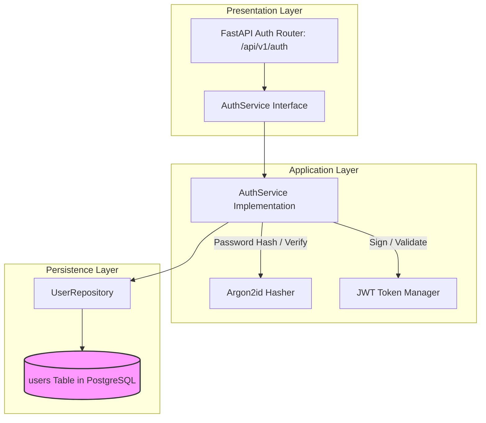

# AUTH MODULE — OVERVIEW & ARCHITECTURE

Version: 1.0  
Status: Authoritative Module Specification  
Owner: Auth & Security Engineering Team  

---

# Executive Summary & Purpose

The `auth` module (`07-modules/auth/`) is the authoritative bounded context responsible for multi-tenant identity verification, user registration, credential hashing, OAuth 2.0 integration, and JWT token issuance across SyncBite and DineGuru.

It enforces the platform authentication strategy specified in [14-adrs/ADR-0004](file:///Users/adith/Documents/Dev/LMX/SyncBite/architecture/14-adrs/ADR-0004-multi-tenant-authentication-identity-strategy.md) and acts as the security gateway for all downstream domain modules.

---

# Module Boundaries & Single-Source-of-Truth

## Included Responsibilities
- User account creation (`users` table).
- Argon2id password hashing and verification.
- Google OAuth 2.0 access token verification.
- Issue and refresh signed 15-minute JWT access tokens and 7-day refresh tokens.
- Maintain RBAC claim definitions (`Customer`, `BranchManager`, `MerchantOwner`, `PlatformAdmin`).

## Excluded Responsibilities (Non-Overlapping Boundaries)
- **Customer Personal Details & Addresses**: Owned exclusively by [07-modules/customer/](file:///Users/adith/Documents/Dev/LMX/SyncBite/architecture/07-modules/customer/README.md).
- **Merchant Legal Registration & KYC**: Owned exclusively by [07-modules/merchant/](file:///Users/adith/Documents/Dev/LMX/SyncBite/architecture/07-modules/merchant/README.md).
- **Administrative Suspension Overrides**: Executed via [08-admin/](file:///Users/adith/Documents/Dev/LMX/SyncBite/architecture/08-admin/README.md).

---

# Architecture & Layering

- **Unidirectional Layering**: Routers delegate directly to `AuthService`. `AuthService` manages transactions and invokes `UserRepository`.
- **Security Boundary**: Database credentials and JWT signing secret keys MUST be injected via environment variables; hardcoded keys are strictly prohibited.
