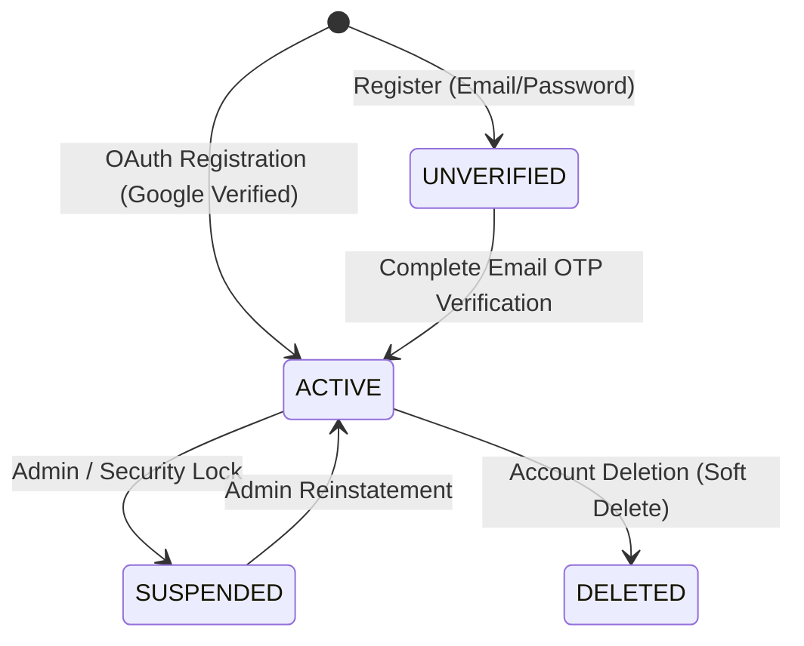
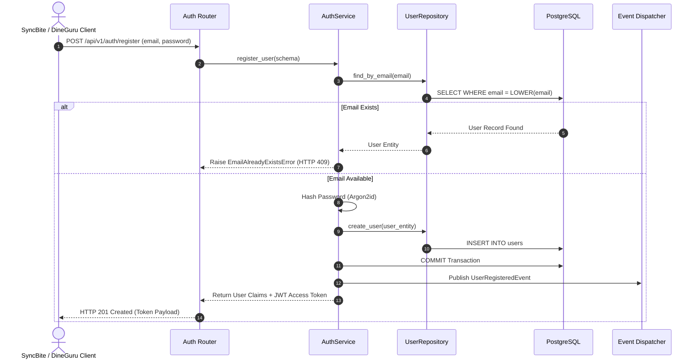

# AUTH MODULE — WORKFLOWS, STATE MACHINES & TESTING SPECIFICATIONS

Version: 1.0  
Status: Authoritative Workflows & Testing Specification  
Owner: Auth & Security Engineering Team  

---

# User Account State Machine

---

# User Registration & Token Issuance Sequence

---

# Published Domain Events

1. **`UserRegisteredEvent`**:
   * **Publisher**: `auth` module.
   * **Payload**: `{ "user_id": "UUIDv7", "email": "...", "role": "Customer", "registered_at": "..." }`
   * **Consumers**: [07-modules/customer/](file:///Users/adith/Documents/Dev/LMX/SyncBite/architecture/07-modules/customer/README.md) (creates customer profile), [07-modules/notification/](file:///Users/adith/Documents/Dev/LMX/SyncBite/architecture/07-modules/notification/README.md) (sends welcome email).

---

# Testing & Operational Observability

## Unit & Integration Testing Strategy
- **Password Hashing Tests**: Verify Argon2id hash generation and constant-time password verification algorithms.
- **JWT Verification Tests**: Test token signature validation, expired token rejection, and tampered claim rejection.
- **Database Boundary Tests**: Verify `LOWER(email)` unique index enforcement during concurrent registration calls.

## Key Operational Metrics (SLIs)
- `auth_login_latency_ms`: p95 latency budget $< 200\text{ms}$.
- `auth_failure_count`: Counter tracking failed login attempts per minute (alerts on threshold $> 50$ indicating brute-force attack).
