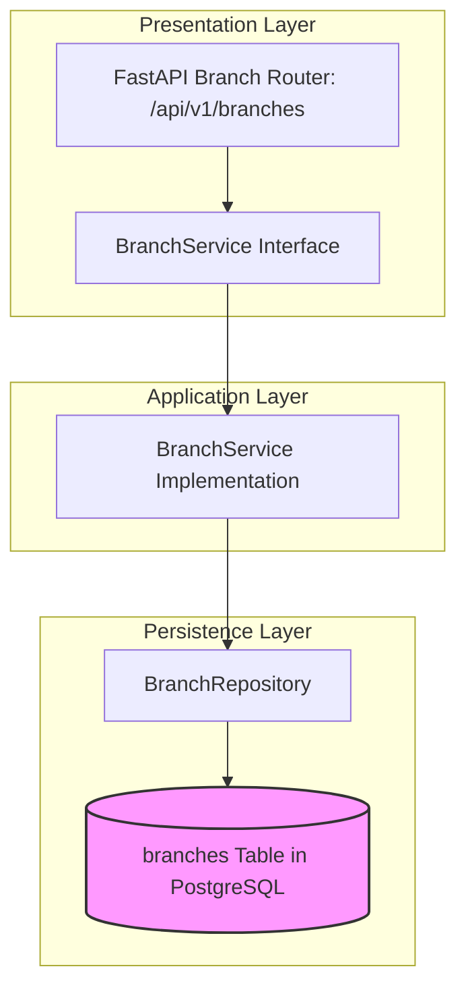

# BRANCH MODULE — OVERVIEW & ARCHITECTURE

Version: 1.0  
Status: Authoritative Module Specification  
Owner: Store & Location Engineering Team  

---

# Executive Summary & Purpose

The `branch` module (`07-modules/branch/`) represents Tier 3 of the 4-tier organizational hierarchy ([14-adrs/ADR-0003](file:///Users/adith/Documents/Dev/LMX/SyncBite/architecture/14-adrs/ADR-0003-merchant-brand-branch-kitchen-hierarchy.md)). It is the authoritative bounded context for physical store locations, store operating hours, store status toggles (ONLINE/OFFLINE), geo-location coordinates, and store delivery radius rules.

---

# Module Boundaries & Single-Source-of-Truth

## Included Responsibilities
- Physical branch profile (`branches` table).
- Store operating hours configuration (`opening_time`, `closing_time`).
- Real-time store status toggling (Merchant ON/OFF override).

## Excluded Responsibilities (Non-Overlapping Boundaries)
- **Kitchen Stations & Order Prep Routing**: Owned exclusively by [07-modules/kitchen/](file:///Users/adith/Documents/Dev/LMX/SyncBite/architecture/07-modules/kitchen/README.md).
- **Branch Catalog & Pricing Overrides**: Owned exclusively by [07-modules/menu/](file:///Users/adith/Documents/Dev/LMX/SyncBite/architecture/07-modules/menu/README.md).

---

# Architecture & Layering

