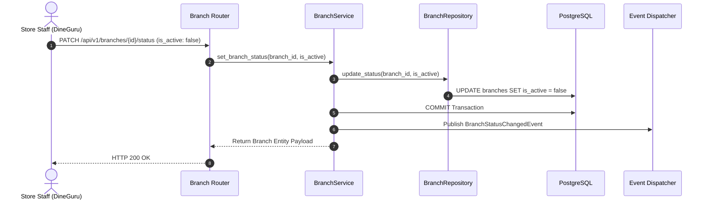

# BRANCH MODULE — WORKFLOWS, STATE MACHINES & TESTING SPECIFICATIONS

Version: 1.0  
Status: Authoritative Workflows & Testing Specification  
Owner: Store & Location Engineering Team  

---

# Branch Operational Status Toggle Workflow

---

# Published Domain Events

1. **`BranchStatusChangedEvent`**:
   * **Publisher**: `branch` module.
   * **Payload**: `{ "branch_id": "UUIDv7", "is_active": false, "updated_at": "..." }`
   * **Consumers**: [07-modules/search/](file:///Users/adith/Documents/Dev/LMX/SyncBite/architecture/07-modules/search/README.md) (invalidates active store search filters), [07-modules/cart/](file:///Users/adith/Documents/Dev/LMX/SyncBite/architecture/07-modules/cart/README.md) (blocks new checkout sessions for offline branch).

---

# Testing & Operational Observability

## Key Operational Metrics (SLIs)
- `branch_status_update_latency_ms`: p95 latency budget $< 80\text{ms}$.
