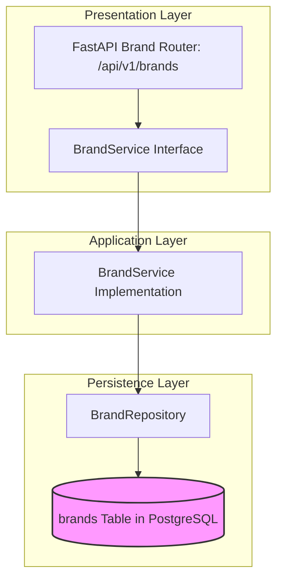

# BRAND MODULE — OVERVIEW & ARCHITECTURE

Version: 1.0  
Status: Authoritative Module Specification  
Owner: Catalog & Merchant Engineering Team  

---

# Executive Summary & Purpose

The `brand` module (`07-modules/brand/`) represents Tier 2 of the 4-tier organizational hierarchy ([14-adrs/ADR-0003](file:///Users/adith/Documents/Dev/LMX/SyncBite/architecture/14-adrs/ADR-0003-merchant-brand-branch-kitchen-hierarchy.md)). It is the authoritative bounded context for marketing identities, brand logos, public restaurant brand assets, and multi-branch brand grouping.

---

# Module Boundaries & Single-Source-of-Truth

## Included Responsibilities
- Brand profile and marketing asset metadata (`brands` table).
- Brand-level default settings and cuisine tags.

## Excluded Responsibilities (Non-Overlapping Boundaries)
- **Merchant Legal Entity**: Owned exclusively by [07-modules/merchant/](file:///Users/adith/Documents/Dev/LMX/SyncBite/architecture/07-modules/merchant/README.md).
- **Physical Store Branches**: Owned exclusively by [07-modules/branch/](file:///Users/adith/Documents/Dev/LMX/SyncBite/architecture/07-modules/branch/README.md).

---

# Architecture & Layering

