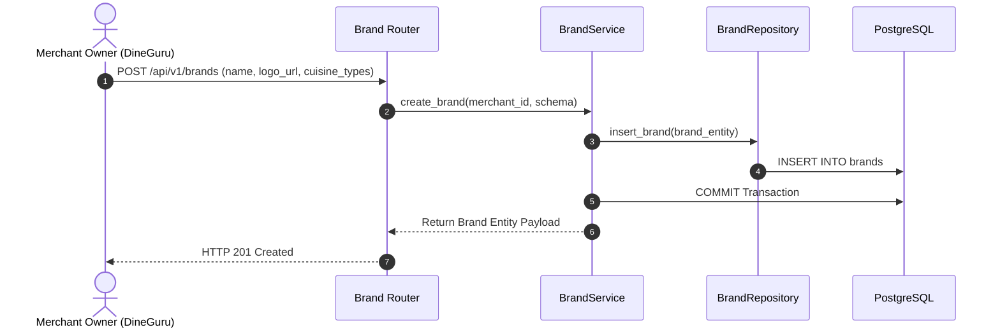

# BRAND MODULE — WORKFLOWS, STATE MACHINES & TESTING SPECIFICATIONS

Version: 1.0  
Status: Authoritative Workflows & Testing Specification  
Owner: Catalog & Merchant Engineering Team  

---

# Brand Management Workflow

---

# Testing & Operational Observability

## Key Operational Metrics (SLIs)
- `brand_read_latency_ms`: p95 latency budget $< 50\text{ms}$.
