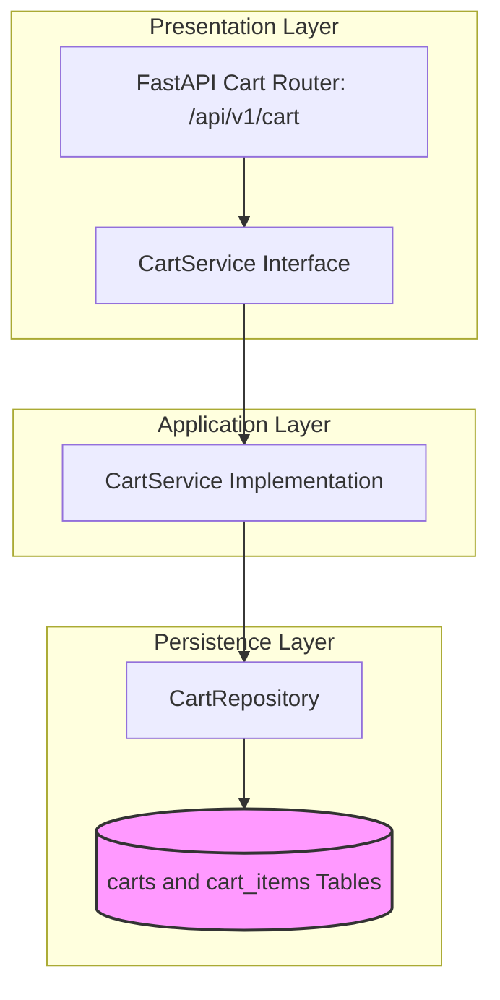

# CART MODULE — OVERVIEW & ARCHITECTURE

Version: 1.0  
Status: Authoritative Module Specification  
Owner: Checkout & Ordering Engineering Team  

---

# Executive Summary & Purpose

The `cart` module (`07-modules/cart/`) is the authoritative bounded context for active customer shopping carts, item customization modifier aggregation, price calculation, and single-branch validation on SyncBite.

---

# Module Boundaries & Single-Source-of-Truth

## Included Responsibilities
- Shopping cart session management (`carts` table).
- Cart items and selected dish modifiers (`cart_items` table).
- Single-branch cart validation.

## Excluded Responsibilities (Non-Overlapping Boundaries)
- **Checkout Validation & Payment Processing**: Owned exclusively by [07-modules/checkout/](file:///Users/adith/Documents/Dev/LMX/SyncBite/architecture/07-modules/checkout/README.md) and [07-modules/payment/](file:///Users/adith/Documents/Dev/LMX/SyncBite/architecture/07-modules/payment/README.md).
- **Catalog Item Master Pricing**: Read-only queries against [07-modules/menu/](file:///Users/adith/Documents/Dev/LMX/SyncBite/architecture/07-modules/menu/README.md).

---

# Architecture & Layering

