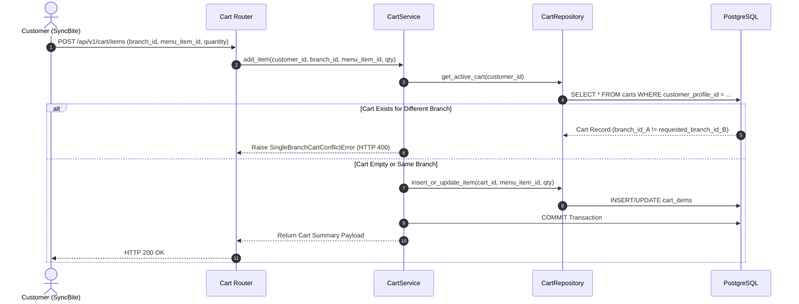

# CART MODULE — WORKFLOWS, STATE MACHINES & TESTING SPECIFICATIONS

Version: 1.0  
Status: Authoritative Workflows & Testing Specification  
Owner: Checkout & Ordering Engineering Team  

---

# Add Item to Cart & Single Branch Enforcement Workflow

---

# Testing & Operational Observability

## Key Operational Metrics (SLIs)
- `cart_item_add_latency_ms`: p95 latency budget $< 100\text{ms}$.
