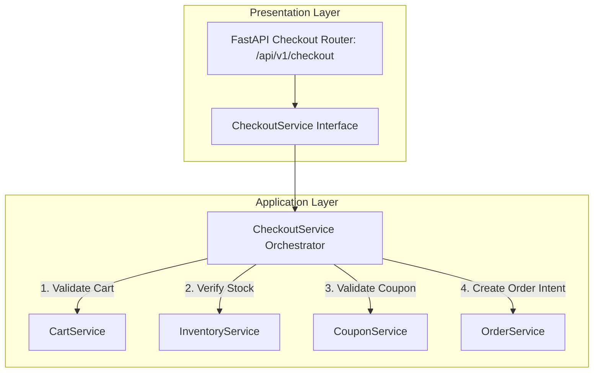

# CHECKOUT MODULE — OVERVIEW & ARCHITECTURE

Version: 1.0  
Status: Authoritative Module Specification  
Owner: Checkout & Ordering Engineering Team  

---

# Executive Summary & Purpose

The `checkout` module (`07-modules/checkout/`) is the authoritative bounded context for transient pre-order checkout session validation, tax/fee calculation, coupon redemption checking, stock availability verification, and order intent creation for SyncBite.

---

# Module Boundaries & Single-Source-of-Truth

## Included Responsibilities
- Transient checkout session validation (`CheckoutSession`).
- Final order price calculations (Item subtotal + Taxes + Delivery fee - Coupon discount).
- Cross-module validation orchestration before order creation.

## Excluded Responsibilities (Non-Overlapping Boundaries)
- **Database Table Write Ownership**: The `checkout` module owns NO database tables. Upon successful validation, it delegates order persistence to [07-modules/order/](file:///Users/adith/Documents/Dev/LMX/SyncBite/architecture/07-modules/order/README.md).

---

# Architecture & Layering

