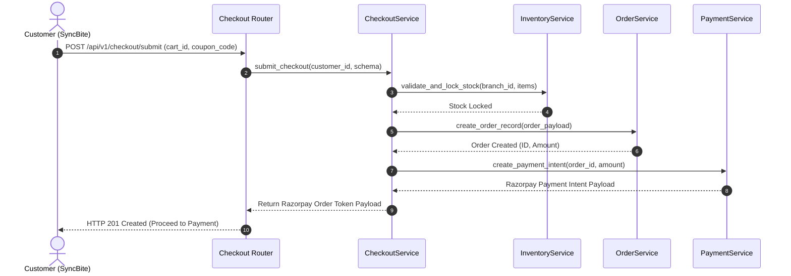

# CHECKOUT MODULE — WORKFLOWS, STATE MACHINES & TESTING SPECIFICATIONS

Version: 1.0  
Status: Authoritative Workflows & Testing Specification  
Owner: Checkout & Ordering Engineering Team  

---

# Checkout Submission Sequence

---

# Testing & Operational Observability

## Key Operational Metrics (SLIs)
- `checkout_submission_latency_ms`: p95 latency budget $< 200\text{ms}$.
- `checkout_abandonment_rate`: Percentage of validated checkout sessions that fail to submit.
