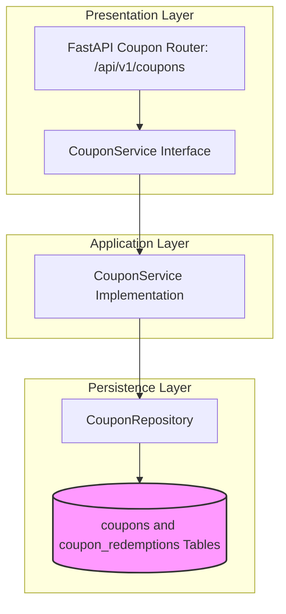

# COUPON MODULE — OVERVIEW & ARCHITECTURE

Version: 1.0  
Status: Authoritative Module Specification  
Owner: Promotions & Marketing Engineering Team  

---

# Executive Summary & Purpose

The `coupon` module (`07-modules/coupon/`) is the authoritative bounded context for discount promotional codes, store-specific vs global coupon rules, usage limit validation, and redemption audit tracking.

---

# Module Boundaries & Single-Source-of-Truth

## Included Responsibilities
- Coupon promotional definitions (`coupons` table).
- Customer redemption tracking (`coupon_redemptions` table).
- Discount calculation algorithms (percentage discount with max cap vs flat amount).

## Excluded Responsibilities (Non-Overlapping Boundaries)
- **Order Checkout Total Calculation**: Invoked as a service dependency during checkout by [07-modules/checkout/](file:///Users/adith/Documents/Dev/LMX/SyncBite/architecture/07-modules/checkout/README.md).

---

# Architecture & Layering

