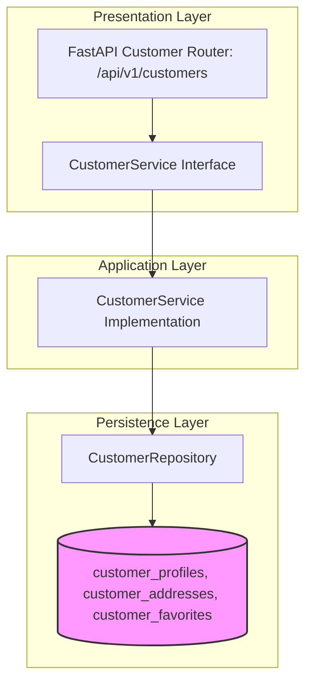

# CUSTOMER MODULE — OVERVIEW & ARCHITECTURE

Version: 1.0  
Status: Authoritative Module Specification  
Owner: Customer Product & Engineering Team  

---

# Executive Summary & Purpose

The `customer` module (`07-modules/customer/`) is the authoritative bounded context responsible for managing customer profile data, delivery addresses, customer preferences, and favorite branch bookmarks for the SyncBite customer ordering web app.

---

# Module Boundaries & Single-Source-of-Truth

## Included Responsibilities
- Customer profile entity management (`customer_profiles` table).
- Saved customer delivery addresses (`customer_addresses` table).
- Favorite store and branch bookmarks (`customer_favorites` table).

## Excluded Responsibilities (Non-Overlapping Boundaries)
- **Authentication & Identity**: Owned exclusively by [07-modules/auth/](file:///Users/adith/Documents/Dev/LMX/SyncBite/architecture/07-modules/auth/overview-and-architecture.md).
- **Order Placement & History**: Owned exclusively by [07-modules/order/](file:///Users/adith/Documents/Dev/LMX/SyncBite/architecture/07-modules/order/README.md).
- **Shopping Cart Session**: Owned exclusively by [07-modules/cart/](file:///Users/adith/Documents/Dev/LMX/SyncBite/architecture/07-modules/cart/README.md).

---

# Architecture & Layering

- **Event Subscriber**: Subscribes to `UserRegisteredEvent` from the `auth` module to automatically initialize a blank `CustomerProfile` row upon user creation.
