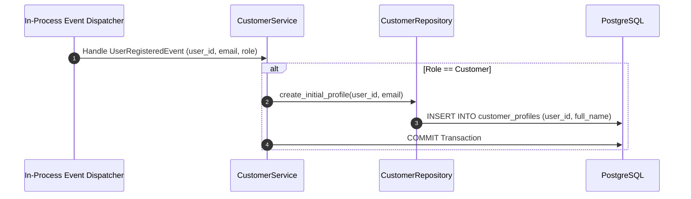

# CUSTOMER MODULE — WORKFLOWS, STATE MACHINES & TESTING SPECIFICATIONS

Version: 1.0  
Status: Authoritative Workflows & Testing Specification  
Owner: Customer Product & Engineering Team  

---

# Customer Profile Initialization Sequence

---

# Testing & Operational Observability

## Unit & Integration Testing Strategy
- **1:1 Mapping Verification**: Test that attempting to insert a second `customer_profiles` row for the same `user_id` throws a database `UniqueViolationError`.
- **Primary Address Atomicity**: Test that marking a new address as primary cleanly updates all previous address records for that customer to `is_primary = FALSE` within a single atomic transaction.

## Key Operational Metrics (SLIs)
- `customer_profile_read_latency_ms`: p95 latency budget $< 50\text{ms}$.
- `customer_address_count`: Counter tracking total active saved delivery addresses per customer.
