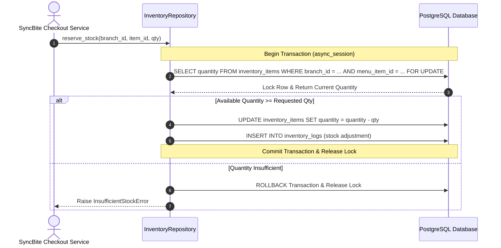

# INVENTORY MODULE — OVERVIEW & ARCHITECTURE

Version: 1.0  
Status: Authoritative Module Specification  
Owner: Kitchen & Inventory Engineering Team  

---

# Executive Summary & Purpose

The `inventory` module (`07-modules/inventory/`) is the authoritative bounded context for dish stock tracking, real-time availability validation, stock adjustment logging, and emergency out-of-stock toggles for DineGuru.

It enforces the Exclusive DineGuru Inventory Write Rule ([14-adrs/ADR-0006](file:///Users/adith/Documents/Dev/LMX/SyncBite/architecture/14-adrs/ADR-0006-inventory-ownership-write-rule.md)) and resolves the platform concurrency control mechanism during high-volume customer checkout.

---

# Inventory Deduction Concurrency Control Resolution

## RESOLUTION SUMMARY: ADOPT PESSIMISTIC ROW-LEVEL LOCKING (`SELECT FOR UPDATE`)
Stock reservation during customer checkout MUST execute via **Pessimistic Row-Level Locking (`SELECT ... FOR UPDATE`)** on the target `inventory_items` row within an atomic database transaction.

## Why Pessimistic Locking Over Optimistic Locking?
During peak campus dining hours at VIT Vellore, popular food items (e.g. 50 rolls/burgers available during 15-minute lunch breaks) experience extreme read/write concurrency. Optimistic concurrency control (using a `version` column) causes severe retry failure cascades under high contention. `SELECT FOR UPDATE` serializes stock updates deterministically at the database row level without throwing client-side concurrency conflicts.

---

# Module Boundaries & Single-Source-of-Truth

## Included Responsibilities
- Item stock quantities and availability flags (`inventory_items` table).
- Immutable stock adjustment ledger (`inventory_logs` table).
- Exclusive DineGuru write routes for merchant stock management ([14-adrs/ADR-0006](file:///Users/adith/Documents/Dev/LMX/SyncBite/architecture/14-adrs/ADR-0006-inventory-ownership-write-rule.md)).

## Excluded Responsibilities (Non-Overlapping Boundaries)
- **Menu Catalog & Pricing**: Owned exclusively by [07-modules/menu/](file:///Users/adith/Documents/Dev/LMX/SyncBite/architecture/07-modules/menu/README.md).
