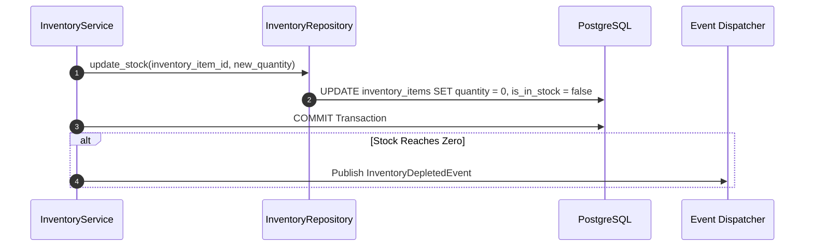

# INVENTORY MODULE — WORKFLOWS, STATE MACHINES & TESTING SPECIFICATIONS

Version: 1.0  
Status: Authoritative Workflows & Testing Specification  
Owner: Kitchen & Inventory Engineering Team  

---

# Stock Depletion Event Workflow

---

# Published Domain Events

1. **`InventoryDepletedEvent`**:
   * **Publisher**: `inventory` module (DineGuru).
   * **Payload**: `{ "branch_id": "UUIDv7", "menu_item_id": "UUIDv7", "status": "OUT_OF_STOCK", "depleted_at": "..." }`
   * **Consumers**: [07-modules/search/](file:///Users/adith/Documents/Dev/LMX/SyncBite/architecture/07-modules/search/README.md), [07-modules/cart/](file:///Users/adith/Documents/Dev/LMX/SyncBite/architecture/07-modules/cart/README.md).

---

# Testing & Operational Observability

## Key Operational Metrics (SLIs)
- `inventory_stock_reservation_latency_ms`: p95 latency budget $< 80\text{ms}$.
- `inventory_oversell_count`: Counter tracking zero-stock checkout attempts (MUST be 0).
