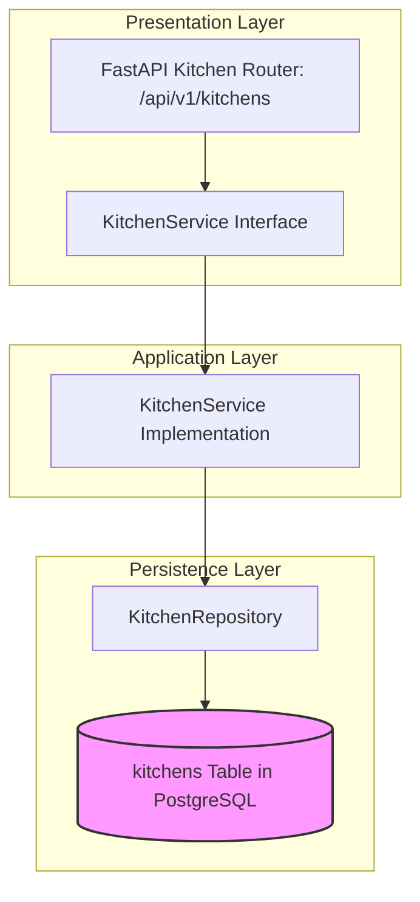

# KITCHEN MODULE — OVERVIEW & ARCHITECTURE

Version: 1.0  
Status: Authoritative Module Specification  
Owner: Kitchen & Dispatch Engineering Team  

---

# Executive Summary & Purpose

The `kitchen` module (`07-modules/kitchen/`) represents Tier 4 of the 4-tier organizational hierarchy ([14-adrs/ADR-0003](file:///Users/adith/Documents/Dev/LMX/SyncBite/architecture/14-adrs/ADR-0003-merchant-brand-branch-kitchen-hierarchy.md)). It is the authoritative bounded context for kitchen preparation units, Kitchen Display System (KDS) prep queues, station routing, and kitchen preparation status dispatching for DineGuru.

---

# Module Boundaries & Single-Source-of-Truth

## Included Responsibilities
- Kitchen unit profile (`kitchens` table).
- Kitchen prep station mapping (e.g. Hot Kitchen, Beverages, Bakery).
- KDS prep queue routing.

## Excluded Responsibilities (Non-Overlapping Boundaries)
- **Order Lifecycle & Customer Order Status**: Owned exclusively by [07-modules/order/](file:///Users/adith/Documents/Dev/LMX/SyncBite/architecture/07-modules/order/README.md).
- **Physical Branch Profile**: Owned exclusively by [07-modules/branch/](file:///Users/adith/Documents/Dev/LMX/SyncBite/architecture/07-modules/branch/README.md).

---

# Architecture & Layering

