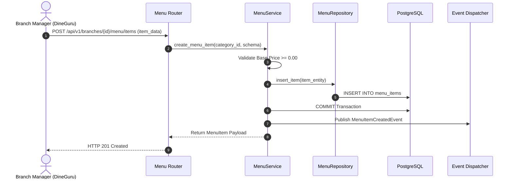

# MENU MODULE — WORKFLOWS, STATE MACHINES & TESTING SPECIFICATIONS

Version: 1.0  
Status: Authoritative Workflows & Testing Specification  
Owner: Catalog & Menu Engineering Team  

---

# Menu Item Creation Workflow

---

# Published Domain Events

1. **`MenuItemCreatedEvent`**:
   * **Publisher**: `menu` module.
   * **Payload**: `{ "menu_item_id": "UUIDv7", "branch_id": "UUIDv7", "base_price": 180.00, "created_at": "..." }`
   * **Consumers**: [07-modules/inventory/](file:///Users/adith/Documents/Dev/LMX/SyncBite/architecture/07-modules/inventory/README.md) (initializes inventory stock record).

---

# Testing & Operational Observability

## Key Operational Metrics (SLIs)
- `menu_fetch_latency_ms`: p95 latency budget $< 50\text{ms}$.
