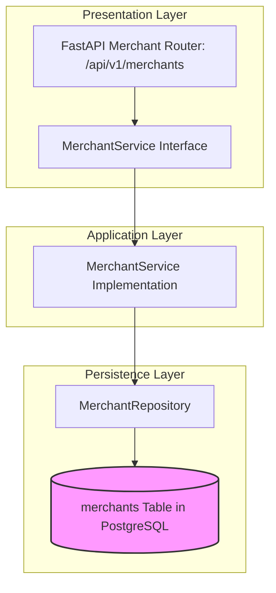

# MERCHANT MODULE — OVERVIEW & ARCHITECTURE

Version: 1.0  
Status: Authoritative Module Specification  
Owner: Merchant Product & Engineering Team  

---

# Executive Summary & Purpose

The `merchant` module (`07-modules/merchant/`) represents Tier 1 of the 4-tier organizational hierarchy ([14-adrs/ADR-0003](file:///Users/adith/Documents/Dev/LMX/SyncBite/architecture/14-adrs/ADR-0003-merchant-brand-branch-kitchen-hierarchy.md)). It is the authoritative bounded context for legal business entities, merchant onboarding, FSSAI tax verification, and financial bank settlement configuration.

---

# Module Boundaries & Single-Source-of-Truth

## Included Responsibilities
- Merchant legal account management (`merchants` table).
- KYC and business registration document validation.
- Bank account details for automated financial payouts.

## Excluded Responsibilities (Non-Overlapping Boundaries)
- **Brand Identities**: Owned exclusively by [07-modules/brand/](file:///Users/adith/Documents/Dev/LMX/SyncBite/architecture/07-modules/brand/README.md).
- **Physical Store Locations**: Owned exclusively by [07-modules/branch/](file:///Users/adith/Documents/Dev/LMX/SyncBite/architecture/07-modules/branch/README.md).
- **Admin Onboarding Approval Workflow**: Triggered via [08-admin/](file:///Users/adith/Documents/Dev/LMX/SyncBite/architecture/08-admin/README.md).

---

# Architecture & Layering

