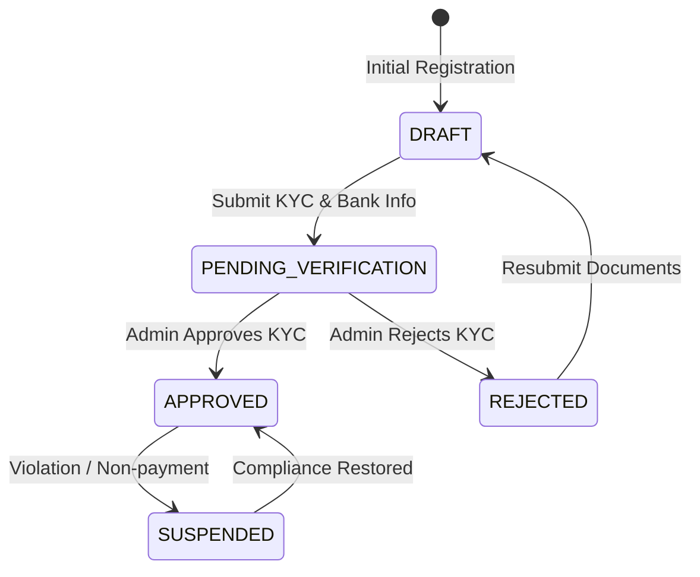

# MERCHANT MODULE — WORKFLOWS, STATE MACHINES & TESTING SPECIFICATIONS

Version: 1.0  
Status: Authoritative Workflows & Testing Specification  
Owner: Merchant Product & Engineering Team  

---

# Merchant Account Lifecycle State Machine

---

# Published Domain Events

1. **`MerchantApprovedEvent`**:
   * **Publisher**: `merchant` module (or admin override).
   * **Payload**: `{ "merchant_id": "UUIDv7", "owner_user_id": "UUIDv7", "approved_at": "..." }`
   * **Consumers**: [07-modules/subscription/](file:///Users/adith/Documents/Dev/LMX/SyncBite/architecture/07-modules/subscription/README.md) (activates trial tier), [07-modules/notification/](file:///Users/adith/Documents/Dev/LMX/SyncBite/architecture/07-modules/notification/README.md) (sends approval notification).

---

# Testing & Operational Observability

## Key Operational Metrics (SLIs)
- `merchant_onboarding_lead_time_hours`: Target $< 24\text{ hours}$ from `PENDING_VERIFICATION` to `APPROVED`.
