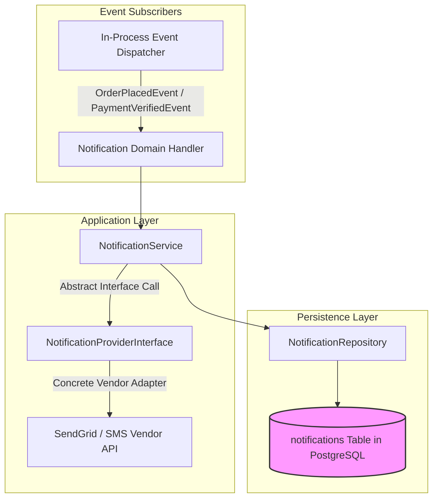

# NOTIFICATION MODULE — OVERVIEW & ARCHITECTURE

Version: 1.0  
Status: Authoritative Module Specification  
Owner: Notification & Messaging Engineering Team  

---

# Executive Summary & Purpose

The `notification` module (`07-modules/notification/`) is the authoritative bounded context for transactional email dispatch, SMS/OTP messaging, and push notifications across SyncBite and DineGuru.

It implements the Provider-Agnostic Notification Adapter Pattern ([14-adrs/ADR-0011](file:///Users/adith/Documents/Dev/LMX/SyncBite/architecture/14-adrs/ADR-0011-provider-agnostic-notification-architecture.md)).

---

# Module Boundaries & Single-Source-of-Truth

## Included Responsibilities
- Transactional notification dispatch logs (`notifications` table).
- Provider-agnostic vendor adapters (`SendGridEmailProvider`, `MockEmailProvider`).
- Non-blocking async execution via FastAPI `BackgroundTasks`.

## Excluded Responsibilities (Non-Overlapping Boundaries)
- **Domain Event Triggers**: Listens to in-process domain events published by `auth`, `order`, and `payment`.

---

# Architecture & Layering

