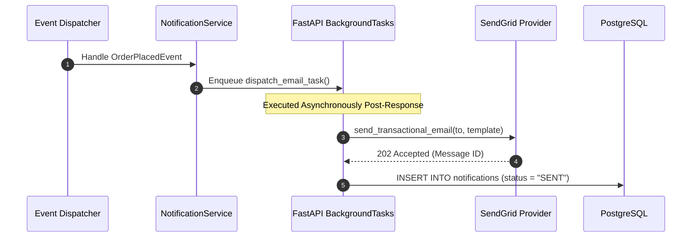

# NOTIFICATION MODULE — WORKFLOWS, STATE MACHINES & TESTING SPECIFICATIONS

Version: 1.0  
Status: Authoritative Workflows & Testing Specification  
Owner: Notification & Messaging Engineering Team  

---

# Async Notification Dispatch Sequence

---

# Testing & Operational Observability

## Key Operational Metrics (SLIs)
- `notification_dispatch_latency_ms`: p95 latency budget $< 1,000\text{ms}$ (async).
