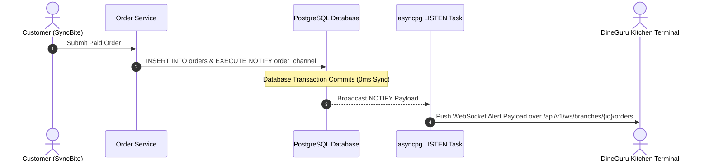

# ORDER MODULE — OVERVIEW & ARCHITECTURE

Version: 1.0  
Status: Authoritative Module Specification  
Owner: Order & Kitchen Fulfillment Team  

---

# Executive Summary & Purpose

The `order` module (`07-modules/order/`) is the central bounded context for order lifecycle management, kitchen preparation status tracking, immutable order history snapshots, and real-time kitchen push notifications for DineGuru.

It implements the in-database order processing model ([14-adrs/ADR-0005](file:///Users/adith/Documents/Dev/LMX/SyncBite/architecture/14-adrs/ADR-0005-in-database-order-processing-model.md)) and resolves real-time order event propagation.

---

# Real-time Order Event Propagation Resolution

## RESOLUTION SUMMARY: ADOPT POSTGRESQL LISTEN/NOTIFY + WEBSOCKET BROADCASTING
Real-time order alerts MUST be propagated via **PostgreSQL `LISTEN/NOTIFY` integrated with FastAPI WebSockets** ([14-adrs/ADR-0010](file:///Users/adith/Documents/Dev/LMX/SyncBite/architecture/14-adrs/ADR-0010-real-time-websocket-architecture.md)).

## Why PostgreSQL `LISTEN/NOTIFY` Over External Message Brokers?
Using PostgreSQL `LISTEN/NOTIFY` guarantees sub-100ms real-time alerting to DineGuru kitchen terminals without deploying external Redis or RabbitMQ infrastructure. Because order records are persisted transactionally in PostgreSQL before `NOTIFY` executes, there is zero risk of lost events or ghost orders.

---

# Module Boundaries & Single-Source-of-Truth

## Included Responsibilities
- Primary order records (`orders` table).
- Ordered dish items and pricing snapshots (`order_items` table).
- Immutable order status audit log (`order_status_logs` table).

## Excluded Responsibilities (Non-Overlapping Boundaries)
- **Payment Settlement & Refunds**: Owned exclusively by [07-modules/payment/](file:///Users/adith/Documents/Dev/LMX/SyncBite/architecture/07-modules/payment/README.md).
- **Inventory Stock Reservation**: Owned exclusively by [07-modules/inventory/](file:///Users/adith/Documents/Dev/LMX/SyncBite/architecture/07-modules/inventory/README.md).
