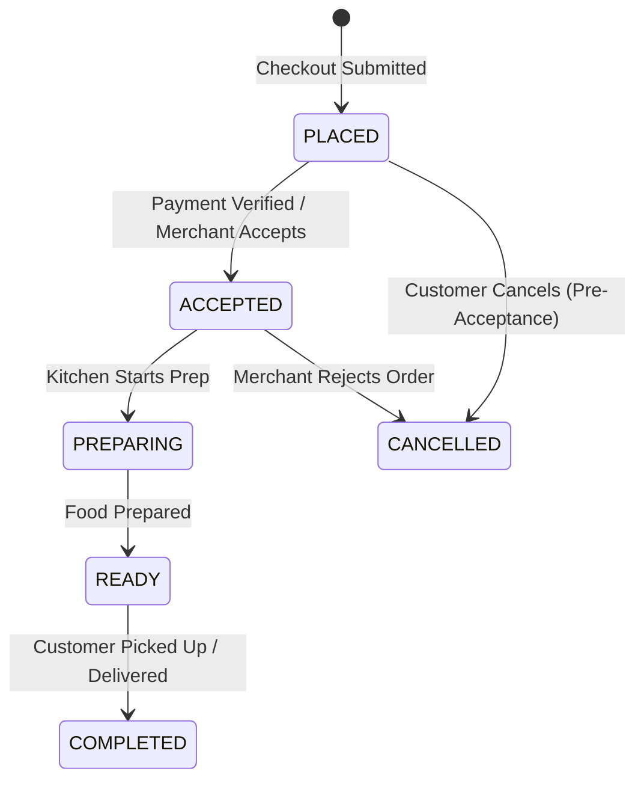

# ORDER MODULE — WORKFLOWS, STATE MACHINES & TESTING SPECIFICATIONS

Version: 1.0  
Status: Authoritative Workflows & Testing Specification  
Owner: Order & Kitchen Fulfillment Team  

---

# Order Lifecycle State Machine

---

# Published Domain Events

1. **`OrderPlacedEvent`**:
   * **Publisher**: `order` module.
   * **Payload**: `{ "order_id": "UUIDv7", "branch_id": "UUIDv7", "customer_profile_id": "UUIDv7", "total_amount": 450.00, "placed_at": "..." }`
   * **Consumers**: [07-modules/notification/](file:///Users/adith/Documents/Dev/LMX/SyncBite/architecture/07-modules/notification/README.md).
2. **`OrderAcceptedEvent`**:
   * **Publisher**: `order` module.
   * **Payload**: `{ "order_id": "UUIDv7", "branch_id": "UUIDv7", "accepted_at": "..." }`
   * **Consumers**: [07-modules/kitchen/](file:///Users/adith/Documents/Dev/LMX/SyncBite/architecture/07-modules/kitchen/README.md).

---

# Testing & Operational Observability

## Key Operational Metrics (SLIs)
- `order_status_update_latency_ms`: p95 latency budget $< 100\text{ms}$.
- `order_cancellation_rate`: Percentage of orders ending in `CANCELLED` status.
