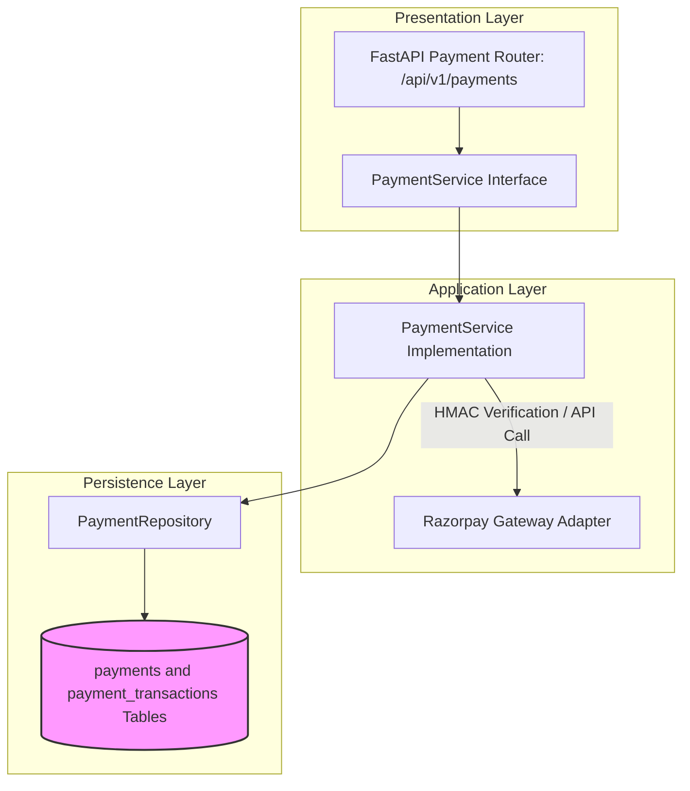

# PAYMENT MODULE — OVERVIEW & ARCHITECTURE

Version: 1.0  
Status: Authoritative Module Specification  
Owner: Payment & Financial Engineering Team  

---

# Executive Summary & Purpose

The `payment` module (`07-modules/payment/`) is the authoritative bounded context for payment intent creation, Razorpay gateway signature verification, asynchronous webhook callback processing, append-only payment transaction logging, and full/partial refund dispatches.

It enforces the Append-Only Payment Ledger & Refund Financial Model ([14-adrs/ADR-0012](file:///Users/adith/Documents/Dev/LMX/SyncBite/architecture/14-adrs/ADR-0012-append-only-payment-ledger-and-refunds.md)).

---

# Module Boundaries & Single-Source-of-Truth

## Included Responsibilities
- Primary payment Intent entity (`payments` table).
- Append-only payment event and refund transaction ledger (`payment_transactions` table).
- Razorpay Webhook HMAC signature verification.

## Excluded Responsibilities (Non-Overlapping Boundaries)
- **Order Lifecycle & Item Pricing**: Owned exclusively by [07-modules/order/](file:///Users/adith/Documents/Dev/LMX/SyncBite/architecture/07-modules/order/README.md).
- **Merchant Platform Commissions & Payouts**: Owned exclusively by [07-modules/subscription/](file:///Users/adith/Documents/Dev/LMX/SyncBite/architecture/07-modules/subscription/README.md).

---

# Architecture & Layering

