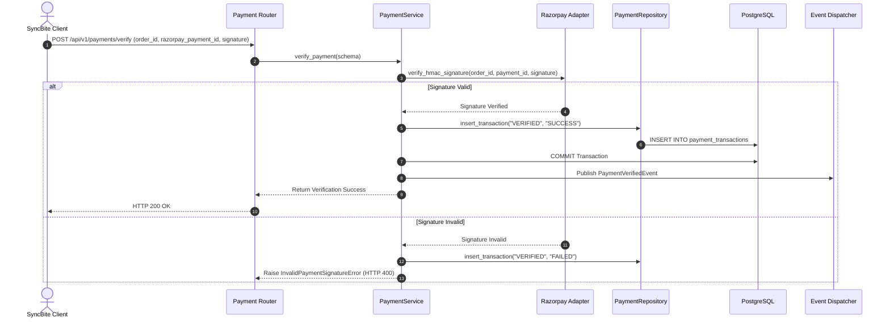

# PAYMENT MODULE — WORKFLOWS, STATE MACHINES & TESTING SPECIFICATIONS

Version: 1.0  
Status: Authoritative Workflows & Testing Specification  
Owner: Payment & Financial Engineering Team  

---

# Payment Signature Verification Sequence

---

# Published Domain Events

1. **`PaymentVerifiedEvent`**:
   * **Publisher**: `payment` module.
   * **Payload**: `{ "payment_id": "UUIDv7", "order_id": "UUIDv7", "razorpay_payment_id": "...", "amount": 450.00, "status": "CAPTURED" }`
   * **Consumers**: [07-modules/order/](file:///Users/adith/Documents/Dev/LMX/SyncBite/architecture/07-modules/order/README.md) (transitions status to `ACCEPTED`), [07-modules/notification/](file:///Users/adith/Documents/Dev/LMX/SyncBite/architecture/07-modules/notification/README.md) (dispatches receipt).

---

# Testing & Operational Observability

## Key Operational Metrics (SLIs)
- `payment_verification_latency_ms`: p95 latency budget $< 100\text{ms}$.
- `payment_failure_rate`: Ratio of failed payment transactions to total intents.
