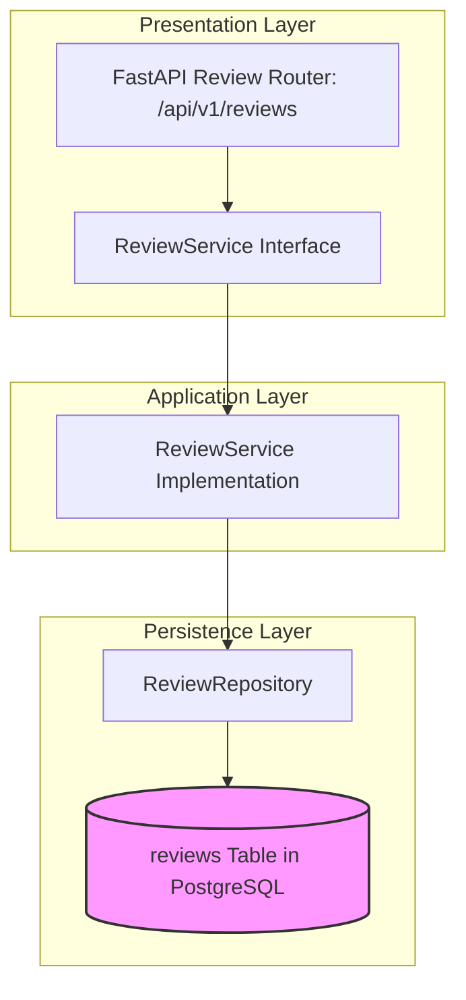

# REVIEW MODULE — OVERVIEW & ARCHITECTURE

Version: 1.0  
Status: Authoritative Module Specification  
Owner: Customer Experience & Reviews Engineering Team  

---

# Executive Summary & Purpose

The `review` module (`07-modules/review/`) is the authoritative bounded context for customer dish and branch ratings, verified order review submissions, and merchant response workflows on SyncBite and DineGuru.

---

# Module Boundaries & Single-Source-of-Truth

## Included Responsibilities
- Verified order review management (`reviews` table).
- Star rating aggregations (1–5 scale) per branch.

## Excluded Responsibilities (Non-Overlapping Boundaries)
- **Order State Verification**: Read-only validation against [07-modules/order/](file:///Users/adith/Documents/Dev/LMX/SyncBite/architecture/07-modules/order/README.md) to confirm completed order ownership (`INV-0007`).

---

# Architecture & Layering

