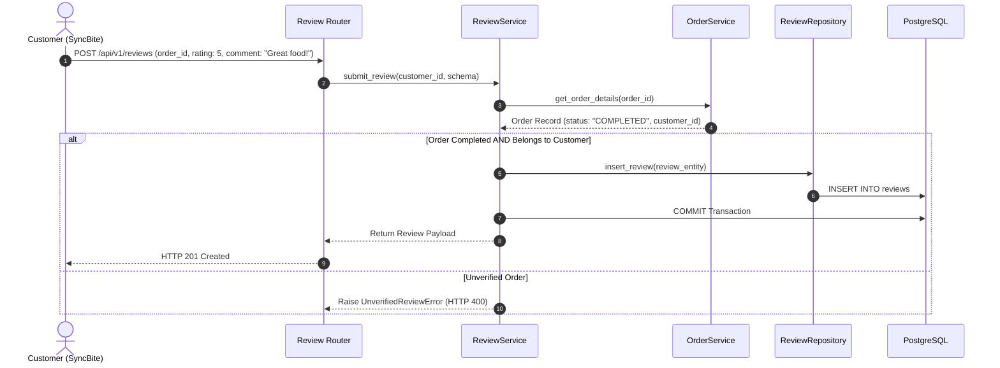

# REVIEW MODULE — WORKFLOWS, STATE MACHINES & TESTING SPECIFICATIONS

Version: 1.0  
Status: Authoritative Workflows & Testing Specification  
Owner: Customer Experience & Reviews Engineering Team  

---

# Verified Review Submission Workflow

---

# Testing & Operational Observability

## Key Operational Metrics (SLIs)
- `review_submission_latency_ms`: p95 latency budget $< 100\text{ms}$.
