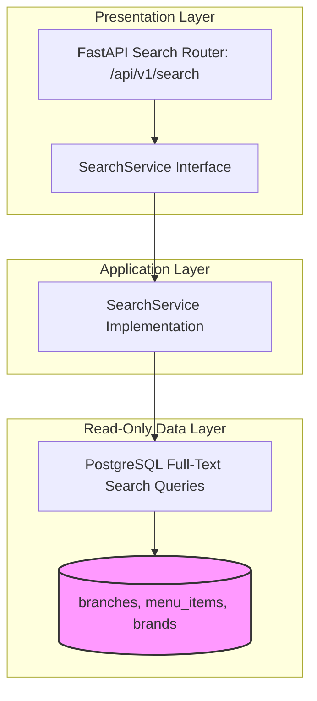

# SEARCH MODULE — OVERVIEW & ARCHITECTURE

Version: 1.0  
Status: Authoritative Module Specification  
Owner: Discovery & Search Engineering Team  

---

# Executive Summary & Purpose

The `search` module (`07-modules/search/`) is the authoritative bounded context for customer food discovery, branch location searching, menu item filtering, and typeahead query suggestions on SyncBite.

It operates as a lightweight, read-only query engine using PostgreSQL full-text search without external search infrastructure (Elasticsearch) per the deferred broker policy ([14-adrs/ADR-0009](file:///Users/adith/Documents/Dev/LMX/SyncBite/architecture/14-adrs/ADR-0009-deferred-redis-and-message-brokers.md)).

---

# Module Boundaries & Single-Source-of-Truth

## Included Responsibilities
- Multi-entity search queries (`branches`, `menu_items`, `brands`).
- Typeahead search suggestions and relevance ranking.

## Excluded Responsibilities (Non-Overlapping Boundaries)
- **Database Table Write Ownership**: The `search` module owns NO database tables; it executes read-only SQL queries against tables owned by `branch`, `menu`, and `brand`.

---

# Architecture & Layering

