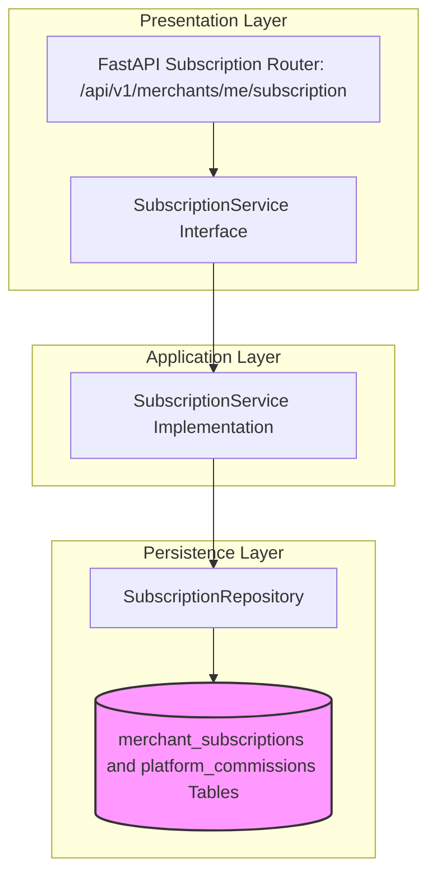

# SUBSCRIPTION MODULE — OVERVIEW & ARCHITECTURE

Version: 1.0  
Status: Authoritative Module Specification  
Owner: Monetization & Billing Engineering Team  

---

# Executive Summary & Purpose

The `subscription` module (`07-modules/subscription/`) is the authoritative bounded context for merchant SaaS subscription plan management, billing tier permissions (Basic, Professional, Enterprise), and per-order platform commission calculations ([01-business/business-model-and-monetization.md](file:///Users/adith/Documents/Dev/LMX/SyncBite/architecture/01-business/business-model-and-monetization.md)).

---

# Module Boundaries & Single-Source-of-Truth

## Included Responsibilities
- Merchant subscription plans and billing cycles (`merchant_subscriptions` table).
- Immutable per-order platform commission financial ledger (`platform_commissions` table).

## Excluded Responsibilities (Non-Overlapping Boundaries)
- **Merchant Legal Profile & Bank Details**: Owned exclusively by [07-modules/merchant/](file:///Users/adith/Documents/Dev/LMX/SyncBite/architecture/07-modules/merchant/README.md).
- **Customer Order Payments**: Owned exclusively by [07-modules/payment/](file:///Users/adith/Documents/Dev/LMX/SyncBite/architecture/07-modules/payment/README.md).

---

# Architecture & Layering

