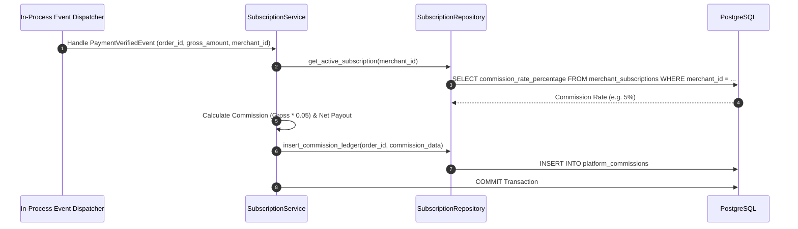

# SUBSCRIPTION MODULE — WORKFLOWS, STATE MACHINES & TESTING SPECIFICATIONS

Version: 1.0  
Status: Authoritative Workflows & Testing Specification  
Owner: Monetization & Billing Engineering Team  

---

# Commission Calculation Sequence

---

# Testing & Operational Observability

## Key Operational Metrics (SLIs)
- `commission_calculation_latency_ms`: p95 latency budget $< 50\text{ms}$.
