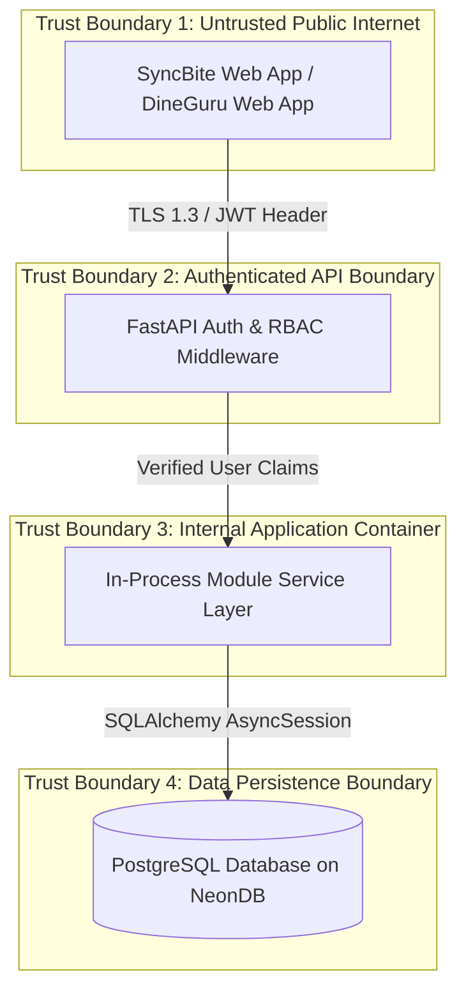

# THREAT MODEL & RBAC AUTHORIZATION SPECIFICATIONS

Version: 1.0  
Status: Authoritative Threat Model & RBAC Specification  
Owner: Chief Architect & Security Engineering Lead  

---

# Purpose

This document specifies the platform STRIDE threat model, trust boundaries, and the authoritative system-wide Role-Based Access Control (RBAC) permission grid.

---

# STRIDE Threat Modeling Matrix

| STRIDE Threat Category | Identified Threat Scenario | Primary Architectural Safeguard |
| :--- | :--- | :--- |
| **Spoofing** | Adversary attempts to forge JWT claims or impersonate another customer. | Mandatory asymmetric RSA256 / HMAC SHA256 JWT signature verification ([14-adrs/ADR-0004](file:///Users/adith/Documents/Dev/LMX/SyncBite/architecture/14-adrs/ADR-0004-multi-tenant-authentication-identity-strategy.md)). |
| **Tampering** | Man-in-the-middle tampering of order totals or Razorpay webhook payloads. | Mandatory TLS 1.3 encryption in transit and Razorpay HMAC SHA256 webhook signature validation. |
| **Repudiation** | Merchant claims an administrative price change or refund was unauthorized. | Mandatory 7-year append-only `admin_audit_logs` tracking user ID, IP address, and timestamp. |
| **Information Disclosure** | Customer PII or merchant bank details exposed via database leak. | AES-256 GCM field-level encryption at rest for sensitive PII in PostgreSQL. |
| **Denial of Service (DoS)** | Brute-force login or checkout flooding during peak campus dining hours. | Rate-limiting middleware (10 req/min for auth; 5 req/min for checkout) and connection pool caps. |
| **Elevation of Privilege** | Customer tampers with JWT role claim to gain `MerchantOwner` or `PlatformAdmin` access. | Server-side role enforcement via `Depends(require_role(...))` checking database-backed claims. |

---

# Full System RBAC Authorization Matrix

Permissions MUST be enforced at the Router layer before delegating to the Service layer.

| System Capability / Endpoint | `Customer` | `KitchenStaff` | `BranchManager` | `MerchantOwner` | `PlatformAdmin` |
| :--- | :--- | :--- | :--- | :--- | :--- |
| **Browse Menus & Search Stores** | ALLOW | ALLOW | ALLOW | ALLOW | ALLOW |
| **Manage Personal Cart & Profile** | ALLOW (BOLA) | DENY | DENY | DENY | DENY |
| **Submit Checkout & Place Order** | ALLOW | DENY | DENY | DENY | DENY |
| **View Active Store Orders (KDS)**| DENY | ALLOW (Branch) | ALLOW (Branch) | ALLOW (All) | ALLOW (All) |
| **Update Order Prep Status** | DENY | ALLOW (Branch) | ALLOW (Branch) | ALLOW (All) | ALLOW (All) |
| **Update Menu Items & Stock** | DENY | ALLOW (Stock) | ALLOW (Branch) | ALLOW (All) | ALLOW (All) |
| **View Merchant Financial Payouts**| DENY | DENY | DENY | ALLOW (Own) | ALLOW (All) |
| **Approve Merchant KYC & Refunds** | DENY | DENY | DENY | DENY | ALLOW |
