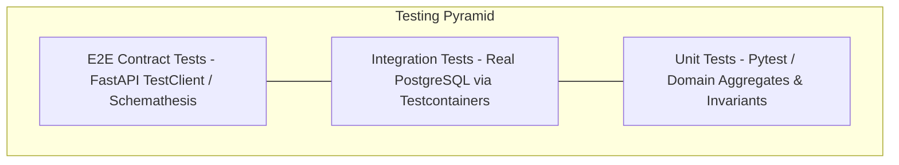

# TESTING STRATEGY & API CONTRACTS SPECIFICATIONS

Version: 1.0  
Status: Authoritative Testing Strategy Specification  
Owner: Chief Architect & Quality Engineering Lead  

---

# Purpose

This document specifies the testing pyramid, unit testing standards, PostgreSQL integration test execution, and API contract verification tools.

---

# Testing Pyramid Architecture

1. **Unit Tests (80% Coverage Target)**: Fast, in-memory Pytest suites testing domain aggregate logic, invoice formulas, Pydantic schemas, and state machine transitions without external I/O.
2. **Integration Tests (60% Coverage Target)**: Executes against real PostgreSQL test containers using `testcontainers-python`, verifying database query performance, foreign keys, and atomic transaction rollbacks.
3. **E2E API Contract Tests**: Verifies OpenAPI schema compliance, 8-attribute endpoint response payloads, and JWT RBAC authentication filters.
