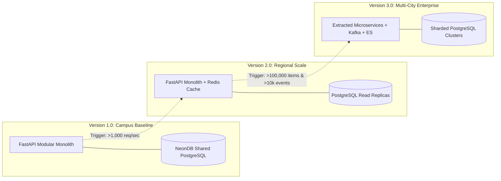

# MULTI-PHASE EVOLUTION ROADMAP SPECIFICATIONS

Version: 1.0  
Status: Authoritative Architecture Evolution Specification  
Owner: Chief Architect & Product Strategy Council  

---

# Purpose

This document formally resolves the final remaining open architectural decision (Decision #5: Post-MVP Caching and Message Broker Triggers) and defines the multi-phase evolution roadmap for SyncBite and DineGuru.

---

# Final Open Architectural Decision Resolution

## RESOLUTION SUMMARY: DEFERRED INFRASTRUCTURE WITH MEASURABLE QUANTITATIVE TRIGGERS
Redis caching, external message brokers (RabbitMQ/Kafka), and specialized search engines (Elasticsearch) MUST NOT be introduced in Version 1.0. 

Infrastructure upgrades MUST be driven strictly by objective, empirical telemetry metrics rather than premature scalability assumptions ([14-adrs/ADR-0009](file:///Users/adith/Documents/Dev/LMX/SyncBite/architecture/14-adrs/ADR-0009-deferred-redis-and-message-brokers.md)).

---

# Architecture Evolution Decision Matrix

| Technology | Baseline Implementation (Version 1.0) | Quantitative Evolution Trigger | Evolution Target (Version 2.0 / 3.0) | Architectural Rationale |
| :--- | :--- | :--- | :--- | :--- |
| **Caching Layer** | PostgreSQL B-Tree Indexes & Memory | Sustained Read Throughput $> 1,000\text{ req/sec}$ OR DB CPU $> 80\%$ for 3 consecutive hours. | **Redis Distributed Cache Cluster** | Offloads catalog read queries (`GET /menu`) during multi-city expansion. |
| **Message Broker** | In-Process Event Dispatcher & `LISTEN/NOTIFY` | Sustained Write Throughput $> 200\text{ req/sec}$ OR In-Memory Event Backlog $> 10,000$ events. | **RabbitMQ / Apache Kafka Cluster** | Ensures persistent, distributed event streaming across decoupled microservices. |
| **Search Engine** | PostgreSQL Full-Text Search (`ILIKE` / TSVector) | Catalog Size $> 100,000\text{ menu items}$ OR Search Latency $> 250\text{ms}$ (p95). | **Elasticsearch / Meilisearch Cluster** | Provides distributed fuzzy search, typo tolerance, and geo-spatial relevance ranking. |
| **Database Scaling** | Shared NeonDB Serverless PostgreSQL | Database Storage $> 1\text{ TB}$ OR Connection Saturation $> 90\%$ post-read-replica setup. | **Horizontal Sharding by City / Region** | Isolates database tenant load by geographic region. |

---

# Multi-Phase Technical Evolution Roadmap

1. **Phase 1 (Version 1.0 Baseline — Current Release)**: Single FastAPI modular monolith container, shared NeonDB PostgreSQL database, in-process async event dispatcher, PostgreSQL `LISTEN/NOTIFY` WebSockets, SendGrid email adapter.
2. **Phase 2 (Version 2.0 Regional Expansion)**: Introduce Redis caching cluster for menu catalog reads upon reaching 1,000 req/sec; add NeonDB read-replicas for query scaling across 5 campus locations.
3. **Phase 3 (Version 3.0 Enterprise Scale)**: Extract `search` and `notification` into independent microservices; adopt Apache Kafka for cross-region event streaming and Elasticsearch for multi-city search.
