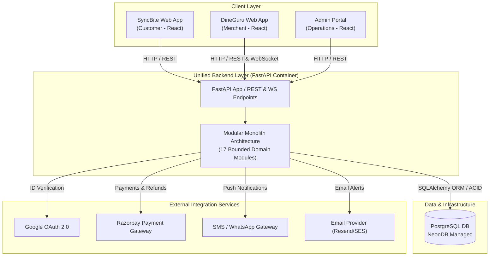
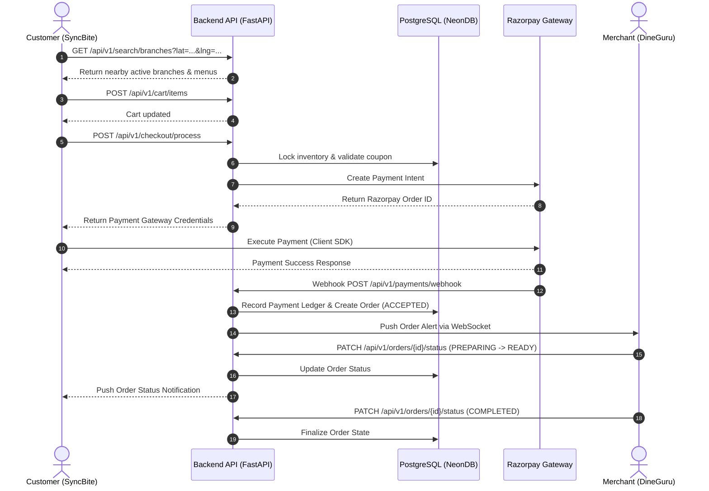

# SyncBite Architecture Overview

## Platform Summary

**SyncBite** is an end-to-end food ordering and restaurant management platform. It consists of two primary application surfaces powered by a unified backend:

*   **SyncBite (Customer Surface):** A responsive, high-performance customer-facing web application where consumers search for nearby restaurants, browse menus, manage carts, apply coupons, place orders, make payments, track order status in real time, and submit reviews.
*   **DineGuru (Merchant Surface):** A dedicated merchant portal where restaurant owners, multi-unit managers, and kitchen staff manage store profiles, operational hours, multi-tier brand/branch hierarchies, menus, stock inventory toggle states, order workflows (accept, prepare, dispatch, complete), payment settlements, and operational analytics.

Both surfaces interact seamlessly through a single, unified backend application and database, ensuring zero data sync lag and strict consistency across customer and merchant operations.

---

## High-Level Architecture

The platform follows a unified container topology comprising frontend client applications, a unified backend API service, a primary relational database, and essential external services.

### Component Roles

*   **SyncBite (Customer Application):** Single-Page Application (React) optimized for customer discovery, ordering, and tracking.
*   **DineGuru (Merchant Application):** Single-Page Application (React) with real-time WebSocket capabilities for instant kitchen alerts, order fulfillment, menu management, and inventory toggling.
*   **Admin Portal:** Internal administration UI for system operators to perform platform moderation, merchant onboarding, brand approvals, coupon management, and feature flag management.
*   **Backend Application:** Production-grade FastAPI (Python) web service executing as a Modular Monolith. Handles business logic, authentication, RBAC, domain event propagation, and background tasks.
*   **PostgreSQL Database (NeonDB):** Serverless PostgreSQL instance providing ACID transactions, strict schema enforcements, row-level locking, and single source-of-truth storage for all domain entities.
*   **External Services:** Provider integrations including Google OAuth 2.0 (social auth), Razorpay (payment capture, webhooks, refunds), and notification vendors (SMS, WhatsApp, Email).

---

## Core Architectural Principles

1.  **Modular Monolith:** The backend is compiled and deployed as a single Python application but structured with strict domain boundary isolation inside independent Python packages.
2.  **Shared PostgreSQL Database:** SyncBite and DineGuru share a single PostgreSQL database instance to guarantee real-time data consistency and eliminate synchronization pipelines.
3.  **Domain-Driven Design (DDD):** Domain models, aggregate roots, value objects, and domain services strictly model business domain boundaries.
4.  **Single Ownership of Data:** Every table and entity has exactly one owning module. No module may execute direct cross-domain SQL queries or mutate state owned by another module.
5.  **API-First Architecture:** All business functions are exposed via strictly versioned REST API contracts with JSON OpenAPI documentation and FastAPI Pydantic schema validation.
6.  **Event-Driven Internal Communication:** Modules communicate asynchronously across boundaries using an in-process memory event dispatcher, preventing tight coupling between domains.
7.  **Future Microservice Extraction:** Clean module interfaces, strict folder boundaries, and zero cross-schema database dependencies permit seamless extraction of domains (e.g., `order` or `payment`) into independent microservices when scale demands it.

---

## Major Business Domains

The platform architecture is partitioned into 17 core domain modules:

*   **Authentication (`auth`):** Handles user registration, Google OAuth, JWT generation/refresh, password hashing, and session management.
*   **Customer (`customer`):** Manages customer profile data, delivery address books, and favorite restaurant listings.
*   **Merchant (`merchant`):** Manages top-level merchant corporate entities, legal documentation, tax registration, and billing payout accounts.
*   **Brand (`brand`):** Manages multi-brand identities owned by top-level merchants.
*   **Branch (`branch`):** Manages physical store locations, geocoded addresses, operating hours, delivery radius, and store status.
*   **Kitchen (`kitchen`):** Manages physical or virtual kitchen stations within branches responsible for preparing specific menu item categories.
*   **Menu (`menu`):** Manages catalog categories, dishes, variants, add-on groups, price rules, and branch-specific menu customizations.
*   **Inventory (`inventory`):** Manages real-time item and variant availability state (in-stock vs. out-of-stock) exclusively controlled via DineGuru.
*   **Search (`search`):** Provides branch discovery, geo-distance filtering, dish text searching, and availability-aware catalog filtering.
*   **Cart (`cart`):** Manages transient multi-item customer shopping carts with strict single-branch validation constraints.
*   **Checkout (`checkout`):** Performs pre-order price calculations, tax computation, delivery fee calculation, and coupon validation.
*   **Order (`order`):** Executes order placement, state transitions (`CREATED` $\rightarrow$ `ACCEPTED` $\rightarrow$ `PREPARING` $\rightarrow$ `READY` $\rightarrow$ `COMPLETED`), and kitchen dispatch.
*   **Payment (`payment`):** Coordinates Razorpay payment intent creation, webhook processing, append-only payment ledgering, and refund workflows.
*   **Coupon (`coupon`):** Manages promotional discount campaigns, validation rules, usage limits, and redemption tracking.
*   **Notification (`notification`):** Dispatches multi-channel alerts (SMS, WhatsApp, Email) and manages DineGuru real-time WebSocket alerts.
*   **Review (`review`):** Collects and computes post-order customer ratings and written feedback for branches and menu items.
*   **Subscription (`subscription`):** Manages merchant platform tier subscriptions, billing cycles, and feature access permissions.

---

## Request Lifecycle

The platform request flow for the primary order placement journey spans customer interaction through merchant fulfillment:

1.  **Search & Discovery:** The customer opens SyncBite, sending position coordinates to `/api/v1/search/branches`. The backend filters open branches within the operational delivery radius.
2.  **Cart & Checkout:** The customer selects items, creating an in-memory/database cart. Upon initiating checkout (`/api/v1/checkout/preview`), the engine validates item availability against the `inventory` module and computes taxes, delivery fees, and discount reductions.
3.  **Payment Initiation:** The customer initiates payment (`/api/v1/payments/create-intent`), generating a Razorpay Order ID.
4.  **Payment Verification & Order Creation:** Upon successful payment on the client, Razorpay sends a signed webhook to `/api/v1/payments/webhook`. The backend verifies the signature, writes to the append-only payment ledger, transitions the order state to `ACCEPTED`, and emits an `OrderCreatedEvent`.
5.  **Merchant Alert & Preparation:** The `notification` module catches the event and pushes an instant alert over an active WebSocket connection to the targeted DineGuru kitchen terminal.
6.  **Kitchen Processing:** Kitchen staff update the order state in DineGuru (`ACCEPTED` $\rightarrow$ `PREPARING` $\rightarrow$ `READY` $\rightarrow$ `COMPLETED`). Each state update notifies the customer via SyncBite real-time updates/SMS.

---

## Technology Stack

*   **FastAPI:** High-performance Python ASGI web framework providing asynchronous request handling, OpenAPI generation, and Pydantic validation.
*   **SQLAlchemy 2.0:** Python ORM and database toolkit using AsyncSession for async SQL execution and explicit model mapping.
*   **PostgreSQL (NeonDB):** Serverless, ACID-compliant relational database platform hosting all platform domain schemas.
*   **React:** Modern frontend component framework powering the SyncBite, DineGuru, and Admin web applications.
*   **JWT (JSON Web Tokens):** Statetoken authentication standard carrying user identity claims and RBAC roles.
*   **Google OAuth 2.0:** Third-party identity provider for fast customer social login and identity verification.
*   **Razorpay:** Integrated payment gateway processing cards, UPI, net banking, webhooks, and automated refund routines.
*   **Alembic:** Database migration management tool for schema versioning and deterministic DDL upgrades.
*   **Docker:** Containerization engine packaging FastAPI services and frontend static builds for cloud deployment.

---

## Scalability Strategy

The architecture adheres to a phased evolution path designed to support platform growth without unnecessary early complexity:

*   **Phase 1 — Modular Monolith (Current):** Single-container deployment hosting all 17 modules, leveraging PostgreSQL for relational storage, transaction locks, and in-database task handling.
*   **Phase 2 — Caching & Offloading (Future Redis):** Introduction of Redis caching for high-read catalog queries, user sessions, search result sets, and distributed rate limiting.
*   **Phase 3 — Asynchronous Task Delegation (Future Message Broker):** Adoption of RabbitMQ or Apache Kafka to transition in-process domain events and heavy background jobs (analytics, notifications, report generation) to distributed worker pools.
*   **Phase 4 — Intelligence & Search Enhancement (Future AI Engine):** Integration of vector search databases and LLM-driven conversational ordering for dish recommendations and semantic menu searching.
*   **Phase 5 — Multi-City Expansion:** Horizontal scaling of database read-replicas, multi-region API deployments, and microservice extraction for high-throughput domains (e.g., `order`, `search`, `inventory`).

---

## Key Design Decisions

Summaries of baseline Architecture Decision Records (ADRs):

*   **[ADR-0001](file:///Users/adith/Documents/Dev/LMX/SyncBite/architecture/14-adrs/ADR-0001-modular-monolith-architecture.md):** Adopted a Production-Grade Modular Monolith architecture to minimize operational overhead while maintaining strict domain boundary isolation.
*   **[ADR-0002](file:///Users/adith/Documents/Dev/LMX/SyncBite/architecture/14-adrs/ADR-0002-shared-postgresql-database.md):** Selected a single shared PostgreSQL database to guarantee strict data consistency across customer and merchant surfaces without data sync pipelines.
*   **[ADR-0003](file:///Users/adith/Documents/Dev/LMX/SyncBite/architecture/14-adrs/ADR-0003-merchant-brand-branch-kitchen-hierarchy.md):** Formulated a 4-tier organizational hierarchy (`Merchant` $\rightarrow$ `Brand` $\rightarrow$ `Branch` $\rightarrow$ `Kitchen`) to support complex multi-unit restaurant operations.
*   **[ADR-0004](file:///Users/adith/Documents/Dev/LMX/SyncBite/architecture/14-adrs/ADR-0004-multi-tenant-authentication-identity-strategy.md):** Established a unified user identity model with role-based access control (RBAC) across customer, merchant, and admin roles.
*   **[ADR-0005](file:///Users/adith/Documents/Dev/LMX/SyncBite/architecture/14-adrs/ADR-0005-in-database-order-processing-model.md):** Enforced real-time in-database ACID transaction processing for orders to prevent double-booking and inconsistent state changes.
*   **[ADR-0006](file:///Users/adith/Documents/Dev/LMX/SyncBite/architecture/14-adrs/ADR-0006-inventory-ownership-write-rule.md):** Designated DineGuru as the exclusive write surface for stock availability toggling to reflect real kitchen inventory.
*   **[ADR-0007](file:///Users/adith/Documents/Dev/LMX/SyncBite/architecture/14-adrs/ADR-0007-in-process-domain-event-propagation.md):** Implemented an in-process memory event dispatcher to decouple cross-module side effects without immediate broker infrastructure.
*   **[ADR-0008](file:///Users/adith/Documents/Dev/LMX/SyncBite/architecture/14-adrs/ADR-0008-api-versioning-and-backward-compatibility.md):** Standardized on URL path API versioning (`/api/v1/`) to ensure deterministic backward compatibility for client applications.
*   **[ADR-0009](file:///Users/adith/Documents/Dev/LMX/SyncBite/architecture/14-adrs/ADR-0009-deferred-redis-and-message-brokers.md):** Deferred Redis and external message broker integration until measured operational thresholds are breached.
*   **[ADR-0010](file:///Users/adith/Documents/Dev/LMX/SyncBite/architecture/14-adrs/ADR-0010-real-time-websocket-architecture.md):** Implemented FastAPI native WebSockets to deliver low-latency order dispatch notifications directly to DineGuru terminals.
*   **[ADR-0011](file:///Users/adith/Documents/Dev/LMX/SyncBite/architecture/14-adrs/ADR-0011-provider-agnostic-notification-architecture.md):** Architected a provider-agnostic notification interface layer allowing seamless vendor swapping for SMS, email, and push channels.
*   **[ADR-0012](file:///Users/adith/Documents/Dev/LMX/SyncBite/architecture/14-adrs/ADR-0012-append-only-payment-ledger-and-refunds.md):** Mandated an append-only transaction ledger model for all payment captures, adjustments, and refunds to guarantee auditability.

---

## Repository Navigation

This overview document serves as a high-level entry point and summary. It does not replace the comprehensive technical specifications contained within the architecture repository.

For complete data schemas, API contracts, domain model diagrams, security rules, and deployment procedures, refer to the following authoritative specification indexes:

*   **[Architecture Master Index](file:///Users/adith/Documents/Dev/LMX/SyncBite/architecture/README.md):** Primary overview and section breakdown.
*   **[Full Specification Directory (SUMMARY.md)](file:///Users/adith/Documents/Dev/LMX/SyncBite/architecture/SUMMARY.md):** Hierarchical table of contents for all specification files.
*   **[Domain Models (`02-domain-model/`)](file:///Users/adith/Documents/Dev/LMX/SyncBite/architecture/02-domain-model/README.md):** Detailed aggregate definitions and invariant specifications.
*   **[Module Specifications (`07-modules/`)](file:///Users/adith/Documents/Dev/LMX/SyncBite/architecture/07-modules/README.md):** Complete specifications for each of the 17 business domain modules.
*   **[Architecture Decision Records (`14-adrs/`)](file:///Users/adith/Documents/Dev/LMX/SyncBite/architecture/14-adrs/README.md):** Full rationale, trade-off matrices, and operational impacts for architectural decisions.
*   **[Domain Glossary (GLOSSARY.md)](file:///Users/adith/Documents/Dev/LMX/SyncBite/architecture/GLOSSARY.md):** Canonical terminology and domain vocabulary definitions.
