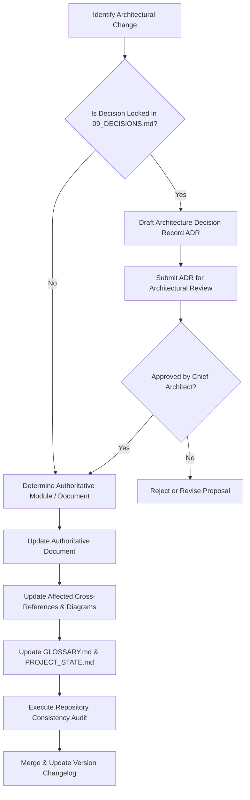

# SYNCBITE ARCHITECTURE CONTRIBUTING GUIDELINES

Version: 1.0  
Status: Authoritative Governance Standard  
Owner: Chief Architect & Engineering Leadership  

---

# Purpose

This document defines the mandatory process for modifying, extending, or updating the SyncBite Architecture Repository. 

Because this repository serves as the 15-year engineering memory and canonical technical specification of the platform, ad-hoc edits, undocumented decisions, and unauthorized architectural drift are strictly prohibited.

---

# Architectural Principles & Governance

1. **Single Source of Truth**: Every business concept, database table, and API contract MUST have exactly one authoritative owner document. Never duplicate explanations across multiple files; use explicit Markdown cross-references instead.
2. **Explain WHY Before HOW**: Any contribution proposing a change MUST detail the business problem, operational context, and trade-off analysis before documenting technical specifications.
3. **No Unexplained Contradictions**: If a new architectural decision conflicts with an existing document, the author MUST update the original document, affected ADRs, ER diagrams, and sequence diagrams simultaneously.
4. **RFC 2119 Normative Language**: All technical requirements MUST use standard RFC 2119 keywords (`MUST`, `MUST NOT`, `SHOULD`, `SHOULD NOT`, `MAY`).

---

# Change Workflow

## Step 1: Proposal & ADR Requirement
An Architecture Decision Record (ADR) MUST be created in `14-adrs/` prior to editing architectural specifications if the change:
- Modifies a locked decision in [09_DECISIONS.md](file:///Users/adith/Documents/Dev/LMX/SyncBite/prompts/09_DECISIONS.md).
- Alters domain ownership boundaries or introduces a new bounded context.
- Introduces new infrastructure (e.g., Redis caching, external brokers, search clusters).
- Modifies primary key strategies, database multi-tenancy models, or concurrency patterns.

## Step 2: Specification Editing
- Edits MUST maintain the consolidated document structure established in [EXECUTION_PLAN.md](file:///Users/adith/Documents/Dev/LMX/SyncBite/architecture/EXECUTION_PLAN.md).
- File fragmentation MUST be avoided by keeping closely related sections consolidated inside their authoritative section document.

## Step 3: Consistency & Cross-Reference Audit
Before submitting changes, the author MUST:
1. Verify that all Markdown file links (`file:///...`) point to valid targets.
2. Add any new domain terms or acronyms to [GLOSSARY.md](file:///Users/adith/Documents/Dev/LMX/SyncBite/architecture/GLOSSARY.md).
3. Update [PROJECT_STATE.md](file:///Users/adith/Documents/Dev/LMX/SyncBite/architecture/PROJECT_STATE.md) tracking metrics.
4. Verify zero forbidden placeholder keywords (`TODO`, `TBD`, `coming later`, `robust`, `scalable`).

---

# Quality Gate Checklist for Pull Requests

- [ ] ADR submitted and approved for major trade-offs.
- [ ] Authoritative owner document updated without duplicate ownership.
- [ ] All cross-references updated and valid.
- [ ] `GLOSSARY.md` updated with new terminology.
- [ ] `PROJECT_STATE.md` updated.
- [ ] `CHANGELOG.md` updated with modification summary.
- [ ] Self-review executed against [08_REVIEWER.md](file:///Users/adith/Documents/Dev/LMX/SyncBite/prompts/08_REVIEWER.md).
