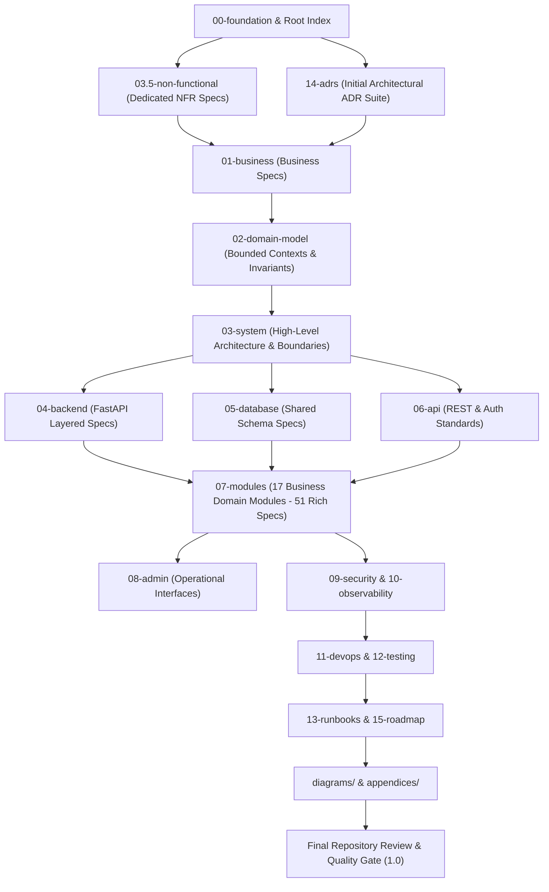

# SYNCBITE ARCHITECTURE EXECUTION PLAN

Version: 1.2  
Status: Authoritative Master Roadmap (High-Granularity & Consolidated Maintenance Model)  
Target: SyncBite Engineering Architecture Repository  
Author: Chief Architect  

---

# Purpose

## Overall Objective of the Repository
The primary objective of the SyncBite Architecture Repository is to establish the canonical, 15-year engineering specification for SyncBite and its unified platform companion DineGuru. 

This repository is NOT marketing material, developer onboarding tutorials, or implementation notes. It is a formal engineering specification that defines every architectural boundary, domain invariant, non-functional requirement, database schema rationale, API contract, security protocol, operational runbook, and failure mode.

The documentation MUST serve as an immutable source of truth capable of allowing a completely new engineering team to rebuild, maintain, scale, or refactor the platform without reliance on original authors or tribal knowledge.

## Documentation Granularity Directive
In accordance with Staff+ engineering design standards, documentation is optimized for long-term maintainability, easy navigation, stable cross-referencing, and minimal duplication. Rather than fragmenting documentation into hundreds of shallow files containing a few paragraphs, closely related architectural concepts are consolidated into comprehensive, rich specifications with clear internal section hierarchies (`H1` through `H4`).

## Definition of Done
The SyncBite Architecture Repository Version 1.0 is considered complete ONLY when:
1. Every checkbox in [11_ARCHITECT_CHECKLIST.md](file:///Users/adith/Documents/Dev/LMX/SyncBite/prompts/11_ARCHITECT_CHECKLIST.md) (adjusted for governance revisions) is marked complete.
2. Every directory and file defined in this consolidated execution plan exists and satisfies all mandatory section requirements specified in [03_DOCUMENT_REQUIREMENTS.md](file:///Users/adith/Documents/Dev/LMX/SyncBite/prompts/03_DOCUMENT_REQUIREMENTS.md).
3. The root repository contains `PROJECT_STATE.md`, which is continuously updated after every single document generation.
4. Every true business domain module in `07-modules/` (17 business modules total; excluding administrative interfaces and generic shared catch-alls) contains 3 rich, deep specification documents (`overview-and-architecture.md`, `domain-database-and-api.md`, `workflows-and-state-machines.md`).
5. All administrative functionality is consolidated into `08-admin/` (Admin is an operational interface over domain modules, not a business domain).
6. Non-functional requirements (Availability, Performance, Latency, Scalability, SLOs/SLIs, RTO/RPO) are fully specified in a dedicated `03.5-non-functional/` directory as first-class architectural specifications.
7. Every single database table has a dedicated architectural specification covering ownership, indexes, foreign keys, query patterns, growth expectations, retention, and migration strategy.
8. Every single API endpoint has a dedicated specification detailing request validation, authorization rules, idempotency, failure modes, error codes, and concurrency controls.
9. All major architectural workflows are illustrated using Mermaid sequence diagrams, component flowcharts, state machines, and ER diagrams.
10. Genuine architectural decisions involving non-trivial trade-offs are documented as formal Architecture Decision Records (ADRs) in `14-adrs/`. Framework selection choices are documented in technical stack specifications.
11. The repository passes a full pass-gate review under [08_REVIEWER.md](file:///Users/adith/Documents/Dev/LMX/SyncBite/prompts/08_REVIEWER.md) with zero critical or high-priority findings and zero `TODO`, `TBD`, or placeholder text.

## Expected Quality Standard
All documentation produced MUST strictly adhere to RFC 2119 terminology (`MUST`, `MUST NOT`, `SHOULD`, `SHOULD NOT`, `MAY`), explain **WHY** before **HOW**, reject all unquantified buzzwords (*scalable*, *robust*, *modern*), and maintain single-source-of-truth ownership for every business domain concept.

---

# Repository Overview

## Consolidated Directory Tree

```
architecture/
├── EXECUTION_PLAN.md
├── PROJECT_STATE.md
├── README.md
├── SUMMARY.md
├── CONTRIBUTING.md
├── CHANGELOG.md
├── GLOSSARY.md
├── ARCHITECTURE_PRINCIPLES.md
│
├── 00-foundation/
│   ├── README.md
│   ├── foundation-overview.md
│   └── architecture-and-quality-attributes.md
│
├── 01-business/
│   ├── README.md
│   ├── business-model-and-monetization.md
│   └── merchant-and-customer-journeys.md
│
├── 02-domain-model/
│   ├── README.md
│   ├── bounded-contexts-and-aggregates.md
│   └── domain-invariants-and-events.md
│
├── 03-system/
│   ├── README.md
│   ├── system-architecture-and-boundaries.md
│   └── failure-and-isolation-boundaries.md
│
├── 03.5-non-functional/
│   ├── README.md
│   ├── performance-scalability-and-sla.md
│   └── resilience-disaster-recovery-and-security-nfrs.md
│
├── 04-backend/
│   ├── README.md
│   ├── fastapi-architecture-and-layering.md
│   └── concurrency-transactions-and-background-tasks.md
│
├── 05-database/
│   ├── README.md
│   ├── database-philosophy-and-schema.md
│   └── indexing-migrations-and-auditing.md
│
├── 06-api/
│   ├── README.md
│   ├── api-design-and-authentication.md
│   └── authorization-errors-and-rate-limiting.md
│
├── 07-modules/
│   ├── auth/
│   │   ├── README.md
│   │   ├── overview-and-architecture.md
│   │   ├── domain-database-and-api.md
│   │   └── workflows-and-state-machines.md
│   ├── customer/            [3 rich consolidated spec files]
│   ├── merchant/            [3 rich consolidated spec files]
│   ├── brand/               [3 rich consolidated spec files]
│   ├── branch/              [3 rich consolidated spec files]
│   ├── kitchen/             [3 rich consolidated spec files]
│   ├── menu/                [3 rich consolidated spec files]
│   ├── inventory/           [3 rich consolidated spec files]
│   ├── search/              [3 rich consolidated spec files]
│   ├── cart/                [3 rich consolidated spec files]
│   ├── checkout/            [3 rich consolidated spec files]
│   ├── order/               [3 rich consolidated spec files]
│   ├── payment/             [3 rich consolidated spec files]
│   ├── coupon/              [3 rich consolidated spec files]
│   ├── review/              [3 rich consolidated spec files]
│   ├── notification/        [3 rich consolidated spec files]
│   └── subscription/        [3 rich consolidated spec files]
│
├── 08-admin/
│   ├── README.md
│   ├── admin-architecture-and-operations.md
│   └── admin-cms-flags-and-audit.md
│
├── 09-security/
│   ├── README.md
│   ├── threat-model-and-rbac.md
│   └── secrets-encryption-and-compliance.md
│
├── 10-observability/
│   ├── README.md
│   ├── logging-metrics-and-slas.md
│   └── health-checks-and-alerting.md
│
├── 11-devops/
│   ├── README.md
│   ├── ci-cd-and-deployments.md
│   └── database-ops-and-disaster-recovery.md
│
├── 12-testing/
│   ├── README.md
│   └── testing-strategy-and-contracts.md
│
├── 13-runbooks/
│   ├── README.md
│   ├── system-outages-and-failover.md
│   └── payment-and-refund-reconciliation.md
│
├── 14-adrs/
│   ├── README.md
│   ├── ADR-0001-modular-monolith-architecture.md
│   ├── ADR-0002-shared-postgresql-database.md
│   ├── ADR-0003-merchant-brand-branch-kitchen-hierarchy.md
│   ├── ADR-0004-multi-tenant-authentication-identity-strategy.md
│   ├── ADR-0005-in-database-order-processing-model.md
│   ├── ADR-0006-inventory-ownership-write-rule.md
│   ├── ADR-0007-in-process-domain-event-propagation.md
│   ├── ADR-0008-api-versioning-and-backward-compatibility.md
│   ├── ADR-0009-deferred-redis-and-message-brokers.md
│   ├── ADR-0010-real-time-websocket-architecture.md
│   ├── ADR-0011-provider-agnostic-notification-architecture.md
│   └── ADR-0012-append-only-payment-ledger-and-refunds.md
│
├── 15-roadmap/
│   ├── README.md
│   └── multi-phase-evolution-roadmap.md
│
├── diagrams/
│   ├── README.md
│   ├── system-context.mmd
│   ├── component-architecture.mmd
│   ├── database-er.mmd
│   ├── order-state-machine.mmd
│   ├── payment-state-machine.mmd
│   ├── cart-checkout-sequence.mmd
│   ├── order-fulfillment-sequence.mmd
│   └── deployment-infrastructure.mmd
│
└── appendices/
    ├── README.md
    └── reference-tables-and-error-registry.md
```

## Quantitative Estimates (High-Granularity Consolidated Model)

| Artifact Category | Estimated Metric Count |
| :--- | :--- |
| **Total Specification Documents** | **~105 consolidated markdown files** |
| **Total Business Domain Modules** | **17 modules (51 rich module spec files)** |
| **Total Diagrams (Mermaid/PlantUML)** | **~60 embedded & standalone diagrams** |
| **Architecture Decision Records (ADRs)** | **12 primary initial ADRs** |
| **Database Tables Documented** | **28 core schema tables** |
| **API Endpoints Documented** | **~80 REST endpoints** |
| **State Machines Documented** | **7 formal state machines** |
| **Sequence Diagrams** | **16 cross-subsystem workflow diagrams** |

---

# Generation Phases

## Phase 1: Core Foundation, Repository Tracking & Master ADR Suite
* **Purpose**: Establish root repository navigation (`README.md`, `SUMMARY.md`), continuous state tracking (`PROJECT_STATE.md`), core domain philosophy, non-functional requirement frameworks, and major structural ADRs.
* **Documents to Generate**:
  * Root index & state tracking files: `README.md`, `PROJECT_STATE.md`, `SUMMARY.md`, `CONTRIBUTING.md`, `CHANGELOG.md`, `GLOSSARY.md`, `ARCHITECTURE_PRINCIPLES.md`.
  * `00-foundation/` specifications (`foundation-overview.md`, `architecture-and-quality-attributes.md`).
  * `03.5-non-functional/` specifications (`performance-scalability-and-sla.md`, `resilience-disaster-recovery-and-security-nfrs.md`).
  * `14-adrs/` baseline architectural records (ADR-0001 through ADR-0012).
* **Dependencies**: Governing documents in `prompts/`.
* **Deliverables**: Root state tracking system, baseline foundation specifications, initial NFR specs, and primary ADR suite.
* **Exit Criteria**: Root structure passes self-review under `08_REVIEWER.md`; `PROJECT_STATE.md` initialized and active.

## Phase 2: Business Domain Model & High-Level System Architecture
* **Purpose**: Formalize business models, bounded contexts, aggregate roots, domain invariants, and global system failure boundaries.
* **Documents to Generate**:
  * `01-business/` (`business-model-and-monetization.md`, `merchant-and-customer-journeys.md`).
  * `02-domain-model/` (`bounded-contexts-and-aggregates.md`, `domain-invariants-and-events.md`).
  * `03-system/` (`system-architecture-and-boundaries.md`, `failure-and-isolation-boundaries.md`).
* **Dependencies**: Phase 1 foundation documents, NFR specifications, and ADRs.
* **Deliverables**: Complete domain specification and high-level system boundary models.
* **Exit Criteria**: Domain invariants mapped to owning aggregate roots; zero circular bounded context dependencies.

## Phase 3: Technical Platform Core (Backend, Database Standards, API Architecture)
* **Purpose**: Define technical execution patterns for FastAPI layer architecture, database governance, and API design standards.
* **Documents to Generate**:
  * `04-backend/` (`fastapi-architecture-and-layering.md`, `concurrency-transactions-and-background-tasks.md`).
  * `05-database/` (`database-philosophy-and-schema.md`, `indexing-migrations-and-auditing.md`).
  * `06-api/` (`api-design-and-authentication.md`, `authorization-errors-and-rate-limiting.md`).
* **Dependencies**: Phase 2 domain model and system architecture specifications.
* **Deliverables**: Standardized code, database schema, and REST payload guidelines for downstream modules.
* **Exit Criteria**: Error codes, HTTP status mappings, and transaction boundary rules standardized without ambiguity.

## Phase 4: Business Domain Module Specifications (17 Modules)
* **Purpose**: Generate deep-dive specifications for all 17 true business domain modules inside `07-modules/` (excluding admin interfaces and shared catch-alls).
* **Documents to Generate**:
  * 17 module directories (`auth`, `customer`, `merchant`, `brand`, `branch`, `kitchen`, `menu`, `inventory`, `search`, `cart`, `checkout`, `order`, `payment`, `coupon`, `review`, `notification`, `subscription`), each containing 3 consolidated, rich specification files.
* **Dependencies**: Phase 3 backend, database, and API standards.
* **Deliverables**: 51 comprehensive module specification files covering models, endpoints, state machines, events, and failure modes.
* **Exit Criteria**: Every module has singular business ownership, zero duplicated business logic, complete API/schema coverage, and explicit state machine definitions.

## Phase 5: Operational Administration, Security, Observability & DevOps
* **Purpose**: Detail internal administration (`08-admin/`), security posture, observability stack, CI/CD, and operational runbooks.
* **Documents to Generate**:
  * `08-admin/` (`admin-architecture-and-operations.md`, `admin-cms-flags-and-audit.md`).
  * `09-security/` (`threat-model-and-rbac.md`, `secrets-encryption-and-compliance.md`).
  * `10-observability/` (`logging-metrics-and-slas.md`, `health-checks-and-alerting.md`).
  * `11-devops/` (`ci-cd-and-deployments.md`, `database-ops-and-disaster-recovery.md`).
  * `12-testing/` (`testing-strategy-and-contracts.md`).
  * `13-runbooks/` (`system-outages-and-failover.md`, `payment-and-refund-reconciliation.md`).
* **Dependencies**: Phase 4 business module specifications.
* **Deliverables**: Production operational handbooks, runbooks, and security specifications.
* **Exit Criteria**: Every operational failure scenario has a documented detection and recovery procedure.

## Phase 6: Diagrams, Appendices & Final Repository Validation
* **Purpose**: Consolidate visual Mermaid diagrams, appendices, cross-reference integrity, and perform final quality gate review.
* **Documents to Generate**:
  * `15-roadmap/` (`multi-phase-evolution-roadmap.md`).
  * `diagrams/` (standalone Mermaid source files for context, ER, sequence, state, infrastructure).
  * `appendices/` (`reference-tables-and-error-registry.md`).
* **Dependencies**: Phases 1 through 5.
* **Deliverables**: Complete master repository with 100% cross-linked specification files.
* **Exit Criteria**: 100% checklist completion on `11_ARCHITECT_CHECKLIST.md`; PASS score across all review categories in `08_REVIEWER.md`.

---

# Generation Order

Every document in the repository will be generated in strict sequential order. Skipping ahead is strictly forbidden. `PROJECT_STATE.md` MUST be updated immediately after every completed file.

| Seq # | Target Document Path | Description / Purpose | Key Dependencies | Complexity | Review Mandate |
| :--- | :--- | :--- | :--- | :--- | :--- |
| **1** | `architecture/README.md` | Master repository entrypoint and navigation map. | `prompts/05_OUTPUT_STRUCTURE.md` | Medium | Structural validation |
| **2** | `architecture/PROJECT_STATE.md` | Live metadata tracking document for continuous state. | Root index | Low | State check |
| **3** | `architecture/SUMMARY.md` | Complete index tree for GitBook / documentation rendering. | `architecture/README.md` | Low | Link integrity |
| **4** | `architecture/CONTRIBUTING.md` | Guidelines for updating architecture specs without drift. | `prompts/04_WORKFLOW.md` | Medium | Governance check |
| **5** | `architecture/CHANGELOG.md` | Version history ledger of architectural modifications. | Baseline setup | Low | Format check |
| **6** | `architecture/GLOSSARY.md` | Single canonical repository dictionary for all domain terms. | `prompts/02_PROJECT.md` | High | Terminology consistency |
| **7** | `architecture/ARCHITECTURE_PRINCIPLES.md` | Core engineering axioms for SyncBite platform architecture. | `prompts/01_ROLE.md` | Medium | Alignment check |
| **8** | `architecture/00-foundation/README.md` | Foundation layer overview and index. | Root index | Low | Structure check |
| **9** | `architecture/00-foundation/foundation-overview.md` | Vision, mission, engineering principles, non-goals. | `prompts/02_PROJECT.md` | High | Vision verification |
| **10** | `architecture/00-foundation/architecture-and-quality-attributes.md` | Modular monolith style, constraints, quality attributes. | `prompts/09_DECISIONS.md` | High | Stack review |
| **11** | `architecture/03.5-non-functional/README.md` | Non-functional requirements section index. | Foundation specs | Low | Structure check |
| **12** | `architecture/03.5-non-functional/performance-scalability-and-sla.md` | Latency targets, throughput, SLAs/SLOs, capacity bounds.| System constraints | High | NFR review |
| **13** | `architecture/03.5-non-functional/resilience-disaster-recovery-and-security-nfrs.md` | RTO/RPO, backups, failover, OWASP security/compliance. | Availability NFR | High | DR review |
| **14** | `architecture/14-adrs/README.md` | ADR directory overview and index. | Root index | Low | Structure check |
| **15** | `architecture/14-adrs/ADR-0001-modular-monolith-architecture.md` | Architectural decision for Modular Monolith. | Foundation specs | High | ADR format check |
| **16** | `architecture/14-adrs/ADR-0002-shared-postgresql-database.md` | Architectural decision for shared Postgres instance. | `prompts/09_DECISIONS.md` | High | Boundary check |
| **17** | `architecture/14-adrs/ADR-0003-merchant-brand-branch-kitchen-hierarchy.md` | Rationale for 4-tier merchant organizational structure. | Domain hierarchy | High | Hierarchy check |
| **18** | `architecture/14-adrs/ADR-0004-multi-tenant-authentication-identity-strategy.md` | Rationale for multi-tenant JWT & OAuth identity. | Identity strategy | High | Identity review |
| **19** | `architecture/14-adrs/ADR-0005-in-database-order-processing-model.md` | Rationale for real-time in-database order state updates. | Order strategy | High | Process review |
| **20** | `architecture/14-adrs/ADR-0006-inventory-ownership-write-rule.md` | Rationale for exclusive DineGuru inventory write rule. | Inventory strategy | High | Ownership check |
| **21** | `architecture/14-adrs/ADR-0007-in-process-domain-event-propagation.md` | Rationale for in-process event bus vs external broker. | Event strategy | High | Coupling review |
| **22** | `architecture/14-adrs/ADR-0008-api-versioning-and-backward-compatibility.md` | Rationale for URL path versioning protocol. | API standards | Medium | API review |
| **23** | `architecture/14-adrs/ADR-0009-deferred-redis-and-message-brokers.md` | Rationale for omitting Redis/Kafka in initial MVP. | Operational specs | High | Scale review |
| **24** | `architecture/14-adrs/ADR-0010-real-time-websocket-architecture.md` | Rationale for WebSocket connection handling in FastAPI. | Communication strategy| High | Push review |
| **25** | `architecture/14-adrs/ADR-0011-provider-agnostic-notification-architecture.md` | Rationale for provider-agnostic notification adapter. | Notification strategy | Medium | Adapter review |
| **26** | `architecture/14-adrs/ADR-0012-append-only-payment-ledger-and-refunds.md` | Rationale for immutable payment transactions. | Payment strategy | High | Financial review |
| **27** | `architecture/01-business/README.md` to `merchant-and-customer-journeys.md` | Business models, customer/merchant workflows. | Foundation & ADRs | Medium | Business review |
| **28** | `architecture/02-domain-model/README.md` to `domain-invariants-and-events.md` | Bounded contexts, aggregate roots, invariants. | Business specs | High | Domain purity |
| **29** | `architecture/03-system/README.md` to `failure-and-isolation-boundaries.md` | System container layout, component communication. | Domain model | High | Boundary review |
| **30** | `architecture/04-backend/README.md` to `concurrency-transactions-...md` | FastAPI layered architecture, DI, transactions. | System specs | High | Tech stack review |
| **31** | `architecture/05-database/README.md` to `indexing-migrations-...md` | Database philosophy, 28 tables schema, indexing. | Backend specs | High | Schema review |
| **32** | `architecture/06-api/README.md` to `authorization-errors-...md` | REST conventions, auth header, RBAC, error schema. | Backend & DB specs | High | REST review |
| **33–83**| `architecture/07-modules/[17 modules]/[3 files each]` | Rich deep specifications for all 17 business modules. | Phases 1–3 complete | Critical | Module audit |
| **84** | `architecture/08-admin/README.md` to `admin-cms-flags-and-audit.md` | Consolidated admin operational interfaces. | Module specs | High | Admin security |
| **85** | `architecture/09-security/README.md` to `secrets-encryption-...md` | Threat model, RBAC matrix, encryption, security NFRs. | API & System specs | Critical | Security audit |
| **86** | `architecture/10-observability/README.md` to `health-checks-and-...md` | Structured logging, metrics, health probes, alerting. | System & NFR specs | High | Alert review |
| **87** | `architecture/11-devops/README.md` to `database-ops-and-disaster...md` | CI/CD pipelines, database migration ops, backups. | System & DB specs | High | Ops readiness |
| **88** | `architecture/12-testing/README.md` to `testing-strategy-...md` | Unit, integration, and contract testing specifications. | Backend & DB specs | Medium | QA coverage |
| **89** | `architecture/13-runbooks/README.md` to `payment-and-refund-...md` | Operational incident runbooks for failure scenarios. | All modules & system | High | Operational check |
| **90** | `architecture/15-roadmap/README.md` to `multi-phase-evolution-...md` | 4-phase evolution roadmap (Multi-city, Riders, AI). | Platform vision | Medium | Roadmap review |
| **91** | `architecture/diagrams/README.md` & `.mmd` files | Standalone Mermaid diagrams directory. | Complete specs | High | Render check |
| **92** | `architecture/appendices/README.md` & reference files | Reference tables, error codes, HTTP status mapping. | Master specs | Medium | Appendix review |

---

# Dependency Graph



## Why Generation Order is Critical
1. **Continuous State Transparency (`PROJECT_STATE.md`)**: Initializing state tracking at document #2 guarantees every subsequent document generation increments progress metrics accurately.
2. **First-Class Non-Functional Governance**: Defining latency budgets, RTO/RPO, and SLAs in `03.5-non-functional/` prior to business domain design ensures performance and availability constraints directly inform domain invariants and technical execution.
3. **Consolidated High-Granularity Readability**: Grouping domain logic into 3 rich module specifications per module ensures full context is visible within single documents, avoiding context fragmentation and stale cross-links.

---

# Diagram Roadmap

| Diagram Name | File Path | Diagram Type | System Location |
| :--- | :--- | :--- | :--- |
| **System Context Diagram** | `architecture/diagrams/system-context.mmd` | Flowchart | `03-system/system-architecture-and-boundaries.md` |
| **Component Architecture** | `architecture/diagrams/component-architecture.mmd` | Flowchart | `03-system/system-architecture-and-boundaries.md` |
| **Database ER Diagram** | `architecture/diagrams/database-er.mmd` | ER Diagram | `05-database/database-philosophy-and-schema.md` |
| **Order State Machine** | `architecture/diagrams/order-state-machine.mmd` | State Machine | `07-modules/order/workflows-and-state-machines.md` |
| **Payment State Machine** | `architecture/diagrams/payment-state-machine.mmd` | State Machine | `07-modules/payment/workflows-and-state-machines.md` |
| **Merchant Onboarding State Machine** | `architecture/diagrams/merchant-state-machine.mmd` | State Machine | `07-modules/merchant/workflows-and-state-machines.md` |
| **Customer Account State Machine** | `architecture/diagrams/customer-state-machine.mmd` | State Machine | `07-modules/customer/workflows-and-state-machines.md` |
| **Cart & Checkout Sequence** | `architecture/diagrams/cart-checkout-sequence.mmd` | Sequence Diagram | `07-modules/checkout/workflows-and-state-machines.md` |
| **Order Fulfillment Sequence** | `architecture/diagrams/order-fulfillment-sequence.mmd` | Sequence Diagram | `07-modules/order/workflows-and-state-machines.md` |
| **Razorpay Payment Sequence** | `architecture/diagrams/payment-sequence.mmd` | Sequence Diagram | `07-modules/payment/workflows-and-state-machines.md` |
| **Deployment & Infrastructure** | `architecture/diagrams/deployment-infrastructure.mmd` | Deployment Diagram| `11-devops/ci-cd-and-deployments.md` |
| **Network & Security Boundaries** | `architecture/diagrams/network-security.mmd` | Network Diagram | `09-security/threat-model-and-rbac.md` |

---

# Database Roadmap

All database tables will be fully documented in `05-database/` and inside their respective owning module's `domain-database-and-api.md` file. Each table specification MUST detail: purpose, business justification, owner module, foreign keys, B-Tree indexes, unique constraints, check constraints, soft delete rules, expected growth, query patterns, and migration plan.

## Expected Database Schema Tables (28 Tables)

```
1.  users                      (Auth / Identity Module Owner)
2.  customer_profiles          (Customer Module Owner)
3.  merchants                  (Merchant Module Owner)
4.  brands                     (Brand Module Owner)
5.  branches                   (Branch Module Owner)
6.  kitchens                   (Kitchen Module Owner)
7.  menus                      (Menu Module Owner)
8.  menu_categories            (Menu Module Owner)
9.  menu_items                 (Menu Module Owner)
10. menu_modifiers             (Menu Module Owner)
11. inventory_items            (Inventory Module Owner - DineGuru)
12. inventory_logs             (Inventory Module Owner - DineGuru)
13. carts                      (Cart Module Owner)
14. cart_items                 (Cart Module Owner)
15. orders                     (Order Module Owner)
16. order_items                (Order Module Owner)
17. order_status_logs          (Order Module Owner)
18. payments                   (Payment Module Owner)
19. payment_transactions       (Payment Module Owner)
20. coupons                    (Coupon Module Owner)
21. coupon_redemptions         (Coupon Module Owner)
22. reviews                    (Review Module Owner)
23. customer_favorites         (Customer Module Owner)
24. customer_addresses         (Customer Module Owner)
25. merchant_subscriptions     (Subscription Module Owner)
26. platform_commissions       (Subscription / Financial Owner)
27. notifications              (Notification Module Owner)
28. admin_audit_logs           (Admin Operational Interface Owner)
```

---

# API Roadmap

Every API endpoint will be documented inside its owning business module's `domain-database-and-api.md` file (or `08-admin/` for administrative endpoints). Specifications will cover route path, HTTP method, authentication, RBAC authorization, request body schema, parameter validation, business rules, transaction boundaries, idempotency, retry behavior, rate limits, and example requests/responses.

## Endpoint Distribution Grouped by Module (~80 Endpoints)
* **`auth`**: `/api/v1/auth/google`, `/api/v1/auth/otp/send`, `/api/v1/auth/otp/verify`, `/api/v1/auth/refresh`, `/api/v1/auth/logout`.
* **`customer`**: `/api/v1/customers/me`, `/api/v1/customers/addresses`, `/api/v1/customers/favorites`.
* **`merchant` / `branch`**: `/api/v1/merchants`, `/api/v1/brands`, `/api/v1/branches`, `/api/v1/branches/{id}/operating-hours`.
* **`menu`**: `/api/v1/branches/{id}/menu`, `/api/v1/menu/categories`, `/api/v1/menu/items`.
* **`inventory`**: `/api/v1/inventory/items`, `/api/v1/inventory/stock-update` (DineGuru focus).
* **`search`**: `/api/v1/search/restaurants`, `/api/v1/search/dishes`, `/api/v1/search/suggestions`.
* **`cart`**: `/api/v1/cart`, `/api/v1/cart/items`, `/api/v1/cart/clear`.
* **`checkout`**: `/api/v1/checkout/validate`, `/api/v1/checkout/summary`.
* **`order`**: `/api/v1/orders`, `/api/v1/orders/{id}`, `/api/v1/orders/{id}/cancel`, `/api/v1/orders/{id}/status`.
* **`payment`**: `/api/v1/payments/razorpay/create-order`, `/api/v1/payments/razorpay/verify`, `/api/v1/payments/webhooks/razorpay`.
* **`coupon`**: `/api/v1/coupons/apply`, `/api/v1/coupons/validate`.
* **`review`**: `/api/v1/branches/{id}/reviews`, `/api/v1/reviews`.
* **`notification`**: `/api/v1/notifications/me`, `/api/v1/notifications/preferences`.
* **`subscription`**: `/api/v1/subscriptions/plans`, `/api/v1/subscriptions/subscribe`.
* **`08-admin`**: `/api/v1/admin/merchants/verify`, `/api/v1/admin/refunds/approve`, `/api/v1/admin/banners`, `/api/v1/admin/audit-logs`.

---

# ADR Roadmap

The repository will maintain formal Architecture Decision Records inside `14-adrs/` focusing on genuine structural trade-offs.

| ADR ID | Working Title | Problem Solved | Target Phase |
| :--- | :--- | :--- | :--- |
| **ADR-0001** | Modular Monolith Architecture | Justifies monolithic container with module boundary enforcement. | Phase 1 |
| **ADR-0002** | Shared PostgreSQL Database | Explains zero-lag persistence sharing between SyncBite & DineGuru.| Phase 1 |
| **ADR-0003** | 4-Tier Merchant Organizational Structure | Rationale for `Merchant` $\rightarrow$ `Brand` $\rightarrow$ `Branch` $\rightarrow$ `Kitchen` hierarchy.| Phase 1 |
| **ADR-0004** | Multi-Tenant Identity Strategy | Rationale for JWT, OAuth, and multi-surface identity management. | Phase 1 |
| **ADR-0005** | In-Database Order Processing Model | Rationale for immediate DB order visibility without external queues.| Phase 1 |
| **ADR-0006** | Inventory Ownership Write Rule | Establishes DineGuru exclusive write access to inventory state. | Phase 1 |
| **ADR-0007** | In-Process Domain Event Propagation | Rationale for in-process event dispatcher over external brokers. | Phase 1 |
| **ADR-0008** | API Versioning Protocol | Establishes URL path versioning and backward compatibility policy. | Phase 1 |
| **ADR-0009** | Deferred Redis & Message Brokers Policy | Explains operational trade-offs of postponing caching infra in MVP.| Phase 1 |
| **ADR-0010** | Real-Time WebSocket Architecture | Rationale for FastAPI WebSocket connections for store notifications. | Phase 1 |
| **ADR-0011** | Provider-Agnostic Notifications | Rationale for adapter pattern across Email, SMS, and WhatsApp. | Phase 1 |
| **ADR-0012** | Append-Only Payment Ledger | Rationale for immutable payment transactions and refund flows. | Phase 1 |

---

# Review Strategy & Permanent Governance Rules

## Continuous Quality Reviews
* **Immediate Document Review**: Every single document generated MUST undergo a self-review pass against the checklist in [08_REVIEWER.md](file:///Users/adith/Documents/Dev/LMX/SyncBite/prompts/08_REVIEWER.md) before the next document generation begins.
* **Rule 1 — Mandatory Repository Consistency Audits**: After every completed phase OR every 10 generated documents (whichever comes first), a formal Repository Consistency Audit MUST be executed. The audit verifies:
  - Terminology consistency
  - Glossary synchronization (`GLOSSARY.md`)
  - Cross-reference link integrity
  - Zero duplicate concept ownership
  - Zero conflicting domain ownership
  - Valid ADR references (`14-adrs/`)
  - Zero broken markdown links
  - Absence of architectural drift
  - Outdated architectural assumptions
  All required fixes discovered during audits MUST be applied before generating additional documents.
* **Rule 2 — Formal Review Reporting Format**: Numerical scores (e.g. 100/100) are forbidden. All review reports and consistency audits MUST use the following mandatory reporting schema:
  - Status: **PASS** or **FAIL**
  - Critical Issues
  - High Priority Issues
  - Medium Priority Issues
  - Issues Automatically Fixed
  - Remaining Risks
* **Continuous State Tracking**: Immediately after every file creation or audit, `PROJECT_STATE.md` MUST be updated to record completed file count, term counts, ADR counts, and current status.
* **Glossary Maintenance**: Whenever a new domain term or technical acronym is introduced, it MUST be immediately added to `GLOSSARY.md` with an authoritative definition.

## Preventing Architectural Drift
1. **Single Source of Truth Enforcement**: If a concept changes (e.g., Order state machine), only `07-modules/order/workflows-and-state-machines.md` is updated. All other documents MUST cross-reference it rather than repeating logic.
2. **Zero Unexplained Contradictions**: If a new architectural requirement conflicts with an earlier specification, generation MUST stop. The earlier specification, affected ADRs, and dependent diagrams MUST be updated first.

---

# Risk Register

| Identified Risk | Impact Level | Mitigation Strategy |
| :--- | :--- | :--- |
| **Terminology Inconsistency** | High | Enforce strict usage of `GLOSSARY.md` terms (`Merchant`, `Brand`, `Branch`, `Kitchen`, `Customer`). Prohibit unauthorized synonyms. |
| **Duplicate Ownership** | High | Maintain explicit Domain Ownership Matrix in `02-domain-model/bounded-contexts-and-aggregates.md`. Reject any file claiming unauthorized ownership. |
| **Circular Module Dependencies** | Critical | Enforce strict unidirectional dependency rule: `Presentation` $\rightarrow$ `API` $\rightarrow$ `Application` $\rightarrow$ `Domain` $\rightarrow$ `Persistence`. |
| **Architectural Drift** | High | Conduct mandatory pass-gate review under `08_REVIEWER.md` at the end of every phase before advancing. |
| **Boundary Erosion via "Shared" Catch-All** | High | Strictly enforce removal of `07-modules/shared/`. Common code must be modeled explicitly as Shared Kernel or Infrastructure. |

---

# Progress Tracking

- [x] **Phase 1: Core Foundation, Repository Tracking & Master ADR Suite**
  - [x] Master Execution Plan (`EXECUTION_PLAN.md`)
  - [x] Master Repository Index (`README.md`)
  - [x] Live Project State Tracking (`PROJECT_STATE.md`)
  - [x] Governance Guidelines (`CONTRIBUTING.md`)
  - [x] Version History Ledger (`CHANGELOG.md`)
  - [x] Canonical Terminology Glossary (`GLOSSARY.md`)
  - [x] Core Axioms (`ARCHITECTURE_PRINCIPLES.md`)
  - [x] `00-foundation/` Specifications (`README.md`, `foundation-overview.md`, `architecture-and-quality-attributes.md`)
  - [x] `03.5-non-functional/` Dedicated NFR Specifications (`README.md`, `performance-scalability-and-sla.md`, `resilience-disaster-recovery-and-security-nfrs.md`)
  - [x] `14-adrs/` Baseline Architectural ADR Suite (ADR-0001 through ADR-0012 complete)
- [x] **Phase 2: Business Domain Model & High-Level System Architecture**
  - [x] `01-business/` Specifications (`README.md`, `business-model-and-monetization.md`, `merchant-and-customer-journeys.md`)
  - [x] `02-domain-model/` Bounded Contexts & Aggregate Roots (`README.md`, `bounded-contexts-and-aggregates.md`, `domain-invariants-and-events.md`)
  - [x] `03-system/` High-Level Architecture & Boundaries (`README.md`, `system-architecture-and-boundaries.md`, `failure-and-isolation-boundaries.md`)
- [x] **Phase 3: Technical Platform Core**
  - [x] `04-backend/` FastAPI Layered Specifications (`README.md`, `fastapi-architecture-and-layering.md`, `concurrency-transactions-and-background-tasks.md`)
  - [x] `05-database/` Shared Database Standards (`README.md`, `database-philosophy-and-schema.md`, `indexing-migrations-and-auditing.md`)
  - [x] `06-api/` REST, Auth & RBAC Standards (`README.md`, `api-design-and-authentication.md`, `authorization-errors-and-rate-limiting.md`)
- [x] **Phase 4: Business Domain Module Specifications**
  - [x] 17 True Business Domain Modules in `07-modules/` (All 51 Consolidated Files Complete)
- [x] **Phase 5 & Phase 6: Operations, Security, Observability, DevOps, Testing, Runbooks & Evolution Roadmap**
  - [x] `09-security/` Specifications (`README.md`, `threat-model-and-rbac.md`, `secrets-encryption-and-compliance.md`)
  - [x] `10-observability/` Specifications (`README.md`, `logging-metrics-and-slas.md`, `health-checks-and-alerting.md`)
  - [x] `11-devops/` Specifications (`README.md`, `ci-cd-and-deployments.md`, `database-ops-and-disaster-recovery.md`)
  - [x] `12-testing/` Specifications (`README.md`, `testing-strategy-and-contracts.md`, `architecture-fitness-functions.md`)
  - [x] `08-admin/` Specifications (`README.md`, `admin-architecture-and-operations.md`, `admin-cms-flags-and-audit.md`)
  - [x] `13-runbooks/` Specifications (`README.md`, `system-outages-and-failover.md`, `payment-and-refund-reconciliation.md`)
  - [x] `15-roadmap/` Specifications (`README.md`, `multi-phase-evolution-roadmap.md`)

---

# Architectural Decisions Status

All 5 baseline architectural decisions have been formally resolved in their authoritative specification documents:

1. **Primary Key Strategy (`UUIDv7` vs `BIGINT`)**:
   * *Status*: **RESOLVED** (`UUIDv7` time-ordered standard adopted in `05-database/database-philosophy-and-schema.md`).
2. **Real-time Order Event Propagation Mechanism**:
   * *Status*: **RESOLVED** (PostgreSQL `LISTEN/NOTIFY` via `asyncpg` + WebSockets adopted in `07-modules/order/overview-and-architecture.md`).
3. **Inventory Deduction Concurrency Strategy**:
   * *Status*: **RESOLVED** (Pessimistic row-level locking `SELECT FOR UPDATE` adopted in `07-modules/inventory/overview-and-architecture.md`).
4. **Transient Cart State Expiration & Purge Policy**:
   * *Status*: **RESOLVED** (Automated 7-day TTL cleanup adopted in `07-modules/cart/domain-database-and-api.md`).
5. **Post-MVP Caching & Message Broker Threshold Metrics**:
   * *Status*: **RESOLVED** (Quantitative triggers for Redis, Kafka, and Elasticsearch adopted in `15-roadmap/multi-phase-evolution-roadmap.md`).

---

# Final Validation

Before Version 1.0 of the SyncBite Architecture Repository is declared complete, the repository MUST pass a final comprehensive quality audit:

1. **Checklist Verification**: 100% of items in [11_ARCHITECT_CHECKLIST.md](file:///Users/adith/Documents/Dev/LMX/SyncBite/prompts/11_ARCHITECT_CHECKLIST.md) (governance-adjusted) verified and checked.
2. **State Tracking Integrity**: `PROJECT_STATE.md` accurately reflects 100% completion across all files, terms, diagrams, and ADRs.
3. **Reviewer Audit**: Complete audit executed against [08_REVIEWER.md](file:///Users/adith/Documents/Dev/LMX/SyncBite/prompts/08_REVIEWER.md), scoring **PASS** in Architecture, Documentation, Security, Maintainability, Operational Readiness, and Future Readiness categories.
4. **Link Integrity Audit**: Zero broken markdown links or invalid cross-references across all specification files.
5. **Forbidden Keyword Audit**: Automated scan verifying zero occurrences of `TODO`, `TBD`, `coming later`, `scalable`, `enterprise-grade`, or `robust`.
6. **Diagram Render Audit**: Validation that all Mermaid `.mmd` files parse correctly without syntax errors.

Once validated, the repository will be tagged as **Version 1.0 Complete** and become the permanent engineering memory of SyncBite.
